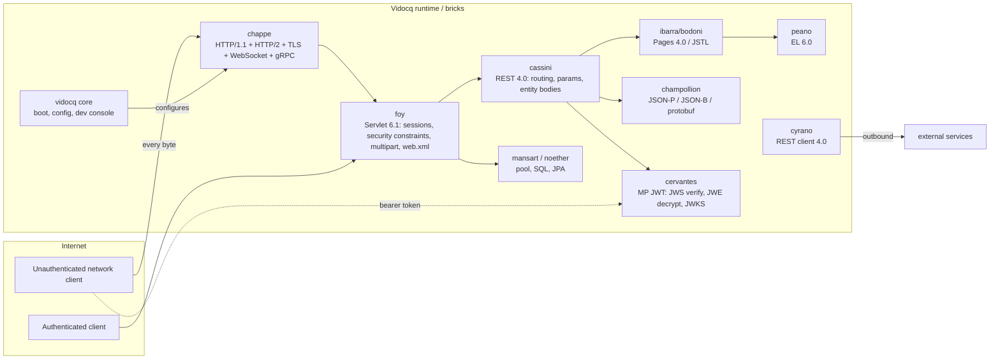
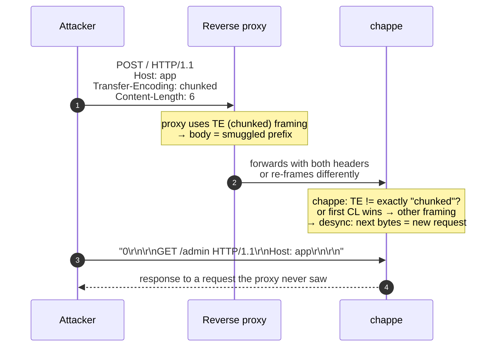

# CYBER_SECU — Security analysis of the Vidocq workspace

- **Date:** 2026-11-02
- **Scope:** all code repositories of the workspace (`<repo>/main/`), plus the shared CI (`ci/main`).
- **Method:** static source review (read-only — no file of any project was modified), focused on the
  network-facing and untrusted-input surfaces, cross-checked against dangerous-pattern greps
  (Java deserialization, `Runtime.exec`/`ProcessBuilder`, MD5/SHA-1, ECB, non-secure `Random`,
  XXE, hardcoded secrets) across every `*/main` source tree.
- **Not done:** no fuzzing, no dynamic penetration test, no dependency scan (the ecosystem ships
  zero runtime dependencies by design, so the code *is* the attack surface).
- **Complements:** `vidocq/main/THREAT-MODEL.md` (draft v0, 2026-10-19) — this report confirms
  several of its "gap" entries in code and adds findings it does not list.

## Executive summary

The codebase is in **good shape overall**: the wire parsers are bounded, response-header injection
is refused at write time, XXE is disabled in `web.xml` parsing, JWT validation uses an algorithm
whitelist with key-family pinning, session ids come from `SecureRandom`, and password comparison
is constant-time with a decoy digest. **No critical, directly exploitable remote-code-execution
flaw was found in the shipped code.**

The most serious finding is a **request-smuggling surface in the HTTP/1.1 framing logic of
chappe** (High when chappe sits behind a reverse proxy, which is the common deployment): requests
whose `Transfer-Encoding` is not exactly `chunked`, or that carry **duplicate, differing
`Content-Length` headers**, are not rejected as RFC 9112 §6.3 requires — chappe silently picks one
interpretation while a front proxy may pick another.

| Severity | Count | Findings |
|---|---|---|
| High | 1 | F-01 request smuggling (framing ambiguity) |
| Medium | 3 | F-02 Java deserialization in Noether, F-03 trusted `X-Forwarded-*`, F-04 CI actions pinned to `@main` |
| Low | 8 | F-05 … F-12 (JWKS over http, WebSocket Origin, session cap, symlink escape, EL reflection default, log injection, JSON-Pointer recursion, connection cap) |
| Info | 2 | F-13 plaintext default listener, F-14 fast password hash (known gap #277) |

## Attack surface map

## Findings

### F-01 — HIGH — HTTP/1.1 request-smuggling surface (framing ambiguity in chappe)

**Where:** `chappe/main/chappe-http/src/main/java/io/vidocq/chappe/http/HttpConnection.java`
(`setupBody()`, ~lines 610–640) and `ArrayHeaders.java` (`firstOrNull`, lines 56–63).

**Evidence.** Three code paths deviate from RFC 9112 §6.3:

1. `Transfer-Encoding` present but **not exactly `chunked`** (e.g. `gzip`, `chunked, gzip`, or a
   second `TE` header — only the *first* value is read) silently falls through to the
   `Content-Length` / no-body path instead of being rejected with 400/501 and closing the
   connection ("the message body length cannot be determined reliably; the server MUST respond
   with 400 and then close").
2. **Duplicate `Content-Length` headers with different values** are not detected:
   `firstOrNull("Content-Length")` returns the first one and the request is accepted. RFC 9112
   requires rejecting the message when the values differ.
3. `Long.parseLong` accepts non-canonical forms (`+5`, `0007`), which different proxies parse
   differently.

**Impact.** When chappe is behind a reverse proxy (nginx, Envoy, oauth2-proxy…), the proxy and
chappe can disagree on where the body ends → classic CL.TE / TE.CL / CL.CL smuggling: the
"leftover" bytes are parsed as a second request, enabling auth-bypass, cache poisoning and
request queue poisoning. Directly exposed, chappe is merely non-compliant (no exploit by
itself).

**Recommendation.** In `setupBody()`: reject with 400 (+ close) when `Transfer-Encoding` is
present and its final coding is not `chunked`; reject when multiple `Content-Length` values are
present and not all identical (also split on commas per RFC 9110 §5.5); reject non-canonical
CL (`+` sign, leading zeros) or at least normalize. Add conformance tests with raw sockets
(`chappe-conformance`) for each case.

### F-02 — MEDIUM — Java deserialization of database bytes without an allowlist (Noether)

**Where:** `noether/main/noether-persistence/noether-jpa-core/src/main/java/io/vidocq/noether/jpa/core/jdbc/type/ValueBinders.java`
(`deserialize`, ~line 509; `UnitObjectInputStream.resolveClass` loads **any** class from the
persistence-unit classloader). Also `session/SecondLevelCache.java` (in-memory, lower risk).

**Impact.** For entity fields mapped as `Serializable`, Noether `readObject()`s raw bytes from the
database. An attacker who can influence the content of such a column (SQL injection elsewhere,
shared/compromised database, multi-tenant DB) can trigger a deserialization gadget chain →
arbitrary code execution. No `ObjectInputFilter` (JEP 290) limits the classes.

**Recommendation.** Install a strict `ObjectInputFilter` (class-name/depth/size limits, allowlist
of the entity's own `Serializable` types) on `UnitObjectInputStream`, or document the requirement
and default-deny for unknown classes. Same review for `SecondLevelCache`.

### F-03 — MEDIUM — `X-Forwarded-For` / `X-Real-IP` / `X-Forwarded-User` trusted unconditionally

**Where:** `chappe/main/chappe-api/src/main/java/io/vidocq/chappe/api/Filter.java`
(`clientIp()`, `clientUser()`, lines ~269–289).

**Evidence.** The access-log filter takes the client IP from the first `X-Forwarded-For` hop (or
`X-Real-IP`) and the user from `X-Forwarded-User` / `Gap-Auth`, with **no trusted-proxy
configuration**: any direct client can set these headers and forge its IP and identity in the
logs.

**Impact.** Log/audit spoofing (repudiation), and — worse — any application code that reuses these
headers for rate limiting, lockout or authorization inherits the spoofing. Safe only behind a
proxy that always overwrites them; there is no way to enforce that in configuration.

**Recommendation.** Add a `trustedProxies` option (CIDR list) to the access-log filter (and a
shared helper for apps): trust forwarding headers only when `remoteAddress()` matches; otherwise
use the socket address. Default to not trusting them when the listener is not loopback/private.

### F-04 — MEDIUM — CI actions referenced by the mutable ref `@main` (supply chain)

**Where:** `ci/main/.forgejo/workflows/pr.yml`, `merge-bot.yml`, `merge-bot-reusable.yml`,
`release-maven/action.yml`, `sonar-analysis/action.yml` — e.g.
`uses: https://codefloe.com/Vidocq/ci/cla-check@main`, `actions/checkout@v4`.

**Evidence.** Remote composite actions and reusable workflows are pinned to a **branch/tag, not a
commit SHA**. These workflows run on `pull_request` and hold secrets (`SLACK_WEBHOOK_URL`,
deploy tokens in `release-maven` / `deploy-maven`).

**Impact.** A compromise (or force-push) of `Vidocq/ci@main` — or of the `actions/checkout@v4`
tag — executes arbitrary code inside every repository's PR pipeline with access to its secrets.
Note the workflows correctly use the `pull_request` trigger (not `pull_request_target`), so PR
code itself is not executed with secrets; the risk is the mutable action reference.

**Recommendation.** Pin every `uses:` to a full commit SHA (with a bot/Dependabot-style updater),
and require SHA-pinning by policy in `ci/CONTRIBUTING.md`.

### F-05 — LOW — JWKS fetch allows cleartext `http://` and unbounded response size

**Where:** `cervantes/main/cervantes-core/src/main/java/io/vidocq/cervantes/internal/JwksSource.java`
(`fromLocation`, `Http.fetch`).

A `mp.jwt.verify.publickey.location` starting with `http://` is fetched in cleartext (MITM can
serve attacker keys → token forgery), and the body is read fully with `ofByteArray()` (no size
cap → memory pressure from a hostile/compromised JWKS endpoint). Positive: the location comes
from configuration, never from token claims — no SSRF via `iss`/`kid`.

**Recommendation.** Warn or refuse `http://` unless explicitly opted in; cap the JWKS body size
(e.g. 1 MiB) and the refresh rate is already bounded (`minRefreshInterval`).

### F-06 — LOW — WebSocket handshake has no `Origin` check (cross-site WebSocket hijacking)

**Where:** `chappe-api/.../DefaultRouterBuilder.java` `webSocket()` (~lines 153–186) validates
`Upgrade`/`Connection`/`Version`/`Key` but not `Origin`; the `Sec-WebSocket-Key` is only checked
non-blank (not base64-of-16-bytes, harmless since the accept value is a hash).

**Impact.** A page on another origin can open a WebSocket to a cookie-authenticated endpoint and
ride the victim's session (CSWSH). This is an application responsibility today; the framework
offers no helper.

**Recommendation.** Add an optional `allowedOrigins(...)` on the WebSocket route builder and
reject mismatches with 403; document the CSWSH duty in the chappe reference page.

### F-07 — LOW — No cap on concurrent connections / active sessions (DoS hardening)

**Where:** `chappe-core` (one virtual thread per connection, `idleTimeout` 60 s bounds idle
keep-alives, but no `maxConnections`), and `foy-core/.../session/InMemorySessionStore.java`
(`ConcurrentHashMap`, idle-expiry sweep, no `maxActiveSessions`).

**Impact.** Slowloris-style pressure is mitigated by `idleTimeout`/`readTimeout`, but an attacker
can still open many connections (each holding a virtual thread + two 16 KiB direct buffers) up to
the OS fd limit, and can create many sessions via `getSession()` calls → memory growth. Bounded
by the OS, hence Low.

**Recommendation.** Add `maxConnections` (reject/close beyond it) and a `maxActiveSessions` with
LRU eviction to the session store.

### F-08 — LOW — Static file handler: lexical path check, symlinks not resolved

**Where:** `chappe-api/.../StaticFileHandler.java` (`PathSource.resolve`).

The `..`/NUL check plus `normalize()` + `startsWith(root)` blocks encoded traversal (the path is
checked **before** decoding and the raw path is what gets resolved, so `%2e%2e` never becomes
`..` — good). However `startsWith` is lexical: a **symlink inside the served root pointing
outside** is followed (no `toRealPath()` comparison). Exploitable only if an attacker can plant a
symlink under the root (e.g. an upload directory served statically).

**Recommendation.** Compare `file.toRealPath()` against `root.toRealPath()` when the file exists.

### F-09 — LOW — Peano EL reflection fallback allowed by default

**Where:** `peano/main/peano-core/.../evaluation/ReflectionGuard.java` —
`System.getProperty("peano.reflection", "allow")` defaults to **allow**: any EL expression can
reach arbitrary methods via reflection.

**Impact.** Fine for build-time-compiled pages (ibarra), but if an application ever evaluates an
EL expression built from request data, this is direct RCE (`Runtime.exec` class). Deny-by-default
with an explicit opt-in would be the safer posture.

**Recommendation.** Default `peano.reflection` to `deny` in production profiles, or log a warning
when reflection fallback is used at runtime.

### F-10 — LOW — Access-log line injection (log forging)

**Where:** `chappe-api/.../Filter.java` `logLine()`; `chappe-http/.../HttpRequestParser.java`.

The request-line parser accepts any byte except CR/LF in the URI and header values (including `"`
and other control chars), and `logLine` writes `method`, `path` and the forwarding headers raw
into one line. CR/LF cannot get through (rejected at parse), so no line-splitting — but quotes and
control chars allow forging the quoted section of a CLF line (combined with F-03's spoofable IP).

**Recommendation.** Escape `"` and non-printable chars when composing the log line.

### F-11 — LOW — JSON-Pointer / JSON-B recursion on deeply nested documents (StackOverflow DoS)

**Where:** `champollion-jsonp/.../ChampollionJsonPointer.java` (`mutateRecursive`, recursive per
nesting level); JSON-B deserialization context is recursive too. The streaming parser itself is
iterative and heap-bounded (depth bitset), so a ~1 MB body of `[[[[…` parses fine, then overflows
the stack in patch/merge operations.

**Recommendation.** Convert the pointer/patch traversal to an explicit stack, or cap the accepted
document depth (e.g. 1000) at parse time.

### F-12 — LOW — `Content-Length: 0` vs absent body, and `Expect: 100-continue` interplay

`setupBody()` returns `null` for `CL: 0`; `100-continue` is only sent after body validation —
correct per RFC 9110 §10.1.1. Noted as reviewed-and-OK; no action. (Listed to show the path was
checked.)

### F-13 — INFO — CLI serves plaintext on `0.0.0.0:8080` by default

**Where:** `chappe-cli/.../ServeCommand.java` (`DEFAULT_HOST = "0.0.0.0"`, `DEFAULT_PORT = 8080`).
Deployment note: `chappe serve` without TLS config exposes cleartext HTTP on all interfaces.
Document prominently; consider binding loopback unless configured otherwise.

### F-14 — INFO — In-memory identity store uses salted but fast SHA-256

**Where:** `foy-core/.../security/InMemoryIdentityStore.java`. Salted (16-byte `SecureRandom`),
constant-time `MessageDigest.isEqual`, decoy digest for unknown users, buffers wiped — good.
The hash is fast (no work factor), so stored hashes are brute-forceable if the map leaks. Already
tracked as gap in `vidocq/main/THREAT-MODEL.md` (#277, PBKDF2/Argon2 for real stores).

## What is solid (verified in code — no action needed)

- **Response-side injection refused:** `HeaderFields` (chappe-api) rejects CR/LF/NUL, non-Latin-1
  chars in header names/values; `HttpResponseWriter` refuses an invalid head with 500 *before any
  byte is sent* and never echoes the offending value (CHAPPE-008). WebSocket subprotocol is
  validated as a token before being echoed.
- **Request smuggling hard parts done right:** obs-fold rejected, `Host` required and unique on
  HTTP/1.1, chunk-size lines bounded (8 KiB) with overflow check, chunked body counted on the wire
  against `maxRequestSize` (10 MiB default), unread bodies drained only within `maxDrainSize`
  then the connection closed, failed body read ⇒ connection closed (no next-request parse on an
  unknown byte position).
- **HTTP/2 abuse bounded:** `SETTINGS_MAX_CONCURRENT_STREAMS` enforced with `REFUSED_STREAM`;
  header-list size cap with `GOAWAY(ENHANCE_YOUR_CALM)`; HPACK dynamic table bounded, invalid
  indexes ⇒ `COMPRESSION_ERROR`; HPACK context kept even for refused streams (no desync);
  CONTINUATION flood capped at `max(4096, advertised)` bytes (CVE-2024-27316 class addressed);
  CONTINUATION interleaving enforced per RFC 9113 §6.10; Upgrade refused on h2 (§8.6).
- **WebSocket:** client frames must be masked, RSV must be 0, control frames ≤125 B and
  unfragmented, payload capped by `maxPayloadSize`, unknown opcodes rejected.
- **TLS:** renegotiation refused on non-TLS-1.3; `clientAuth` off by default; handshake bounded by
  `idleTimeout`.
- **XXE:** `foy WebXmlParser` — secure processing on, external DTD/entities off, empty
  `EntityResolver`.
- **JWT (cervantes):** `alg` whitelist RS256/384/512 + ES256/384/512 only — `none` and `HS256`
  rejected; key family must match the alg (no RSA-key-as-HMAC confusion); optional
  `requiredAlgorithm`; keys come only from the configured JWKS (no `iss`-driven fetch ⇒ no
  SSRF), `kid` lookup with single-key fallback and rate-bounded refresh; `exp`/`nbf`/`iat`/age
  with clock skew; JWE restricted to RSA-OAEP(-256) + A256GCM with `cty=JWT` enforced (GCM ⇒ no
  padding oracle). TCK 206/206 per the threat model.
- **Sessions/auth (foy):** 128-bit `SecureRandom` session ids, id rotated at login, cookie
  defaults `HttpOnly` + `Secure` (request-derived) + `SameSite=Lax`; constant-time credential
  check with decoy; multipart bounded (10 MiB body, 50 parts, 8 KiB per part header, bare CR/LF
  rejected); security constraints enforced before filters (TCK 59/59).
- **JSON parsing (champollion):** iterative parser (no recursion on nesting), strict string
  escapes (control chars and bad `\u` rejected), numbers kept lexical and parsed lazily.
- **Misc:** MD5 appears only for ETag (documented non-security); SHA-1 only in the RFC 6455
  WebSocket GUID (mandated); no `Runtime.exec`/`ProcessBuilder` on any request path, no
  `ObjectInputStream` outside Noether/ibarra-build-time; no non-secure `Random` in security
  contexts; dev console binds `127.0.0.1` by default; CI uses `pull_request` (not
  `pull_request_target`) and quotes the PR-controlled `HEAD_REF`/`HEAD_REPO` in shell scripts.

## Suggested priority order

1. F-01 (smuggling) — small, well-localized fix in `HttpConnection.setupBody()` + conformance tests.
2. F-04 (CI SHA-pinning) — mechanical, removes a whole supply-chain class.
3. F-02 (Noether `ObjectInputFilter`), F-03 (trusted-proxy option for forwarding headers).
4. Then the Low items (F-05…F-11) and the two Info notes.

## Limitations

Static review only: no fuzzing of the HTTP/2/HPACK/chunked decoders (already flagged #271 in the
threat model), no dynamic test of the smuggling scenarios, no review of the examples' application
code beyond spot checks, build tooling (Maven plugins, APT) out of scope per the threat model.
Line numbers are as of 2026-11-02 on `main`.
