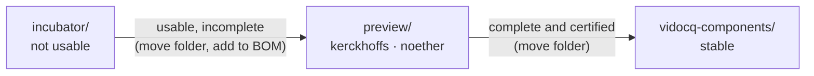
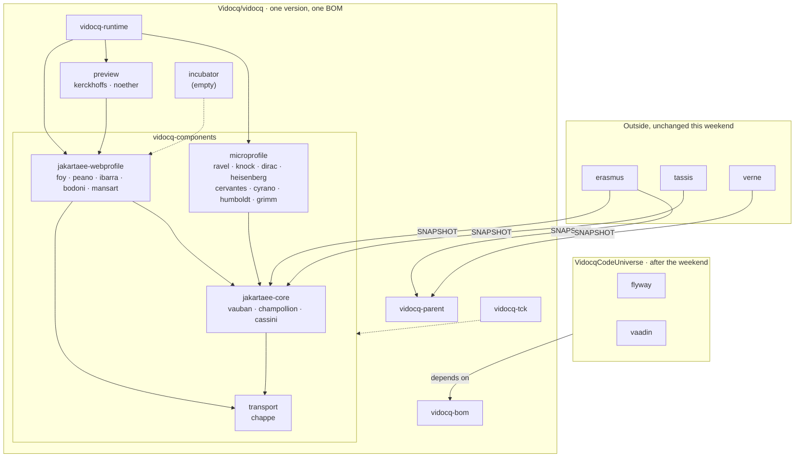
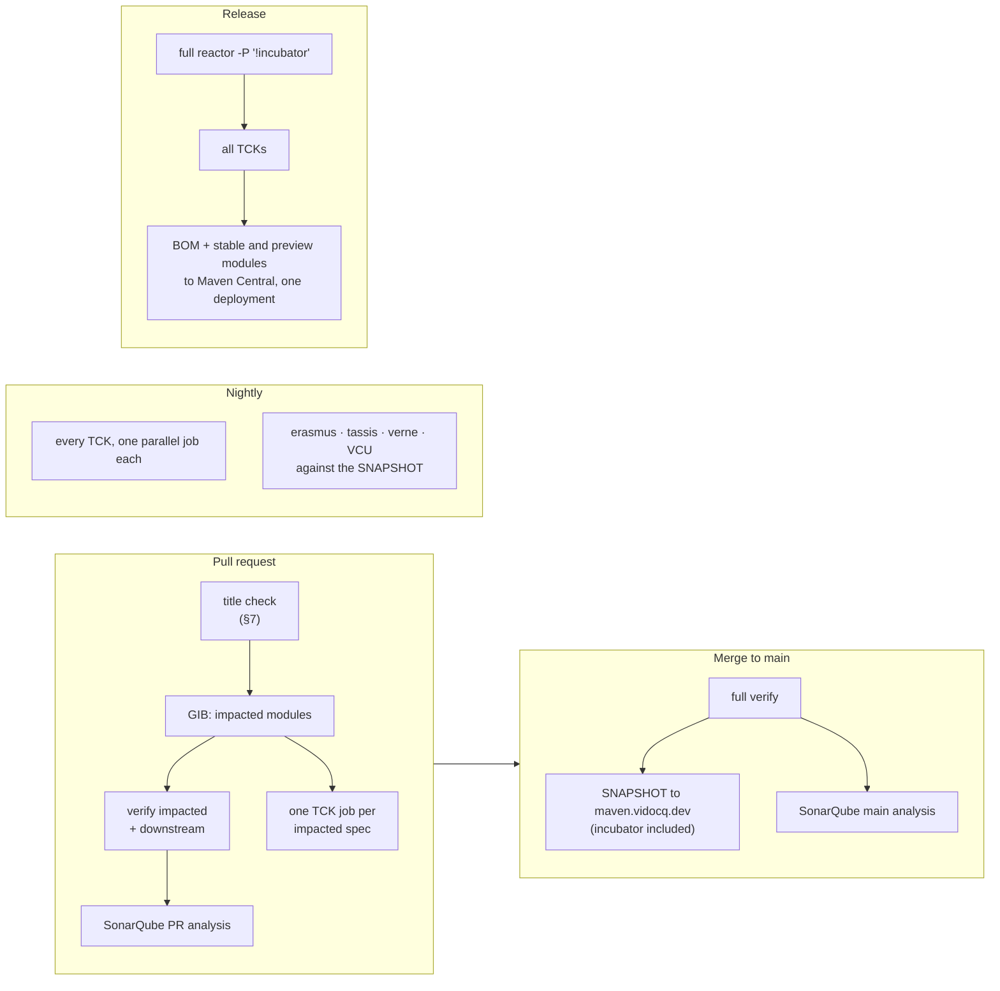
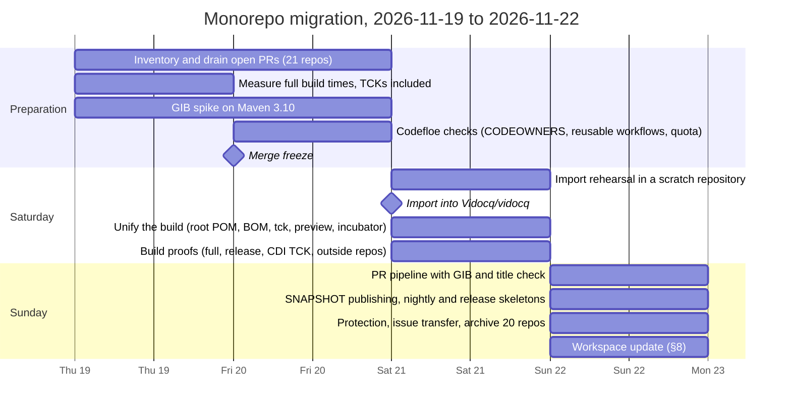
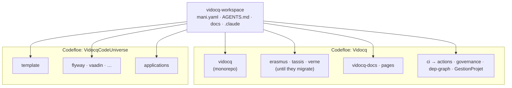

# MONOREPO.md

Migration plan of the Vidocq runtime repositories into one monorepo, `Vidocq/vidocq`, over the weekend of
2026-11-21/22. Source: the RFC "Vidocq monorepo, incubator and VCU" (2026-11-17). This file records the decisions
taken on 2026-11-18, the target layout, the weekend steps, the rules for pull requests in the monorepo, and what
becomes of `vidocq-workspace`.

## 1. Decisions

| Topic                        | Decision                                                                                       |
|------------------------------|------------------------------------------------------------------------------------------------|
| Monorepo                     | The existing `Vidocq/vidocq` repository. Its current content moves to `vidocq-runtime/`.       |
| Repositories imported        | 21: `vidocq-parent`, `vidocq` and the 19 bricks listed in §3.                                   |
| Repositories not touched     | `erasmus`, `tassis`, `verne`: their developers migrate them later, themselves.                 |
| Maturity folders             | Three levels, each with the same group tree below it: `vidocq-components/` (stable), `preview/` (incomplete or not certified, but usable: `kerckhoffs`, `noether`), `incubator/` (not usable, empty at first). `peano`, `ibarra`, `bodoni` are stable. |
| Flyway extension             | Stays in `vidocq-runtime/` until the VCU organisation exists.                                  |
| langchain4j-cdi MCP extension | Goes to VCU (Yann, 2026-11-19). Like Flyway, it stays in `vidocq-runtime/` until VCU exists, unpublished (`maven.deploy.skip`) and out of the CLI catalog; it does not ship with 0.4.0. vidocq#204 moves to the VCU repository `vidocq_vcu_extension_lc4jcdi` (Yann, 2026-11-19). |
| VCU organisation             | After the weekend (RFC step 6).                                                                |
| Issues of archived repos     | Transferred to `Vidocq/vidocq`.                                                                |
| First monorepo release       | 0.4.0 (milestone due 2026-11-30).                                                              |
| Incremental PR builds        | gitflow-incremental-builder (GIB) 4.6.0 from day one; git-diff script as fallback.             |
| PR titles                    | Component prefix, plus `[WIP]` when not ready (§7).                                            |
| Coordinates                  | groupIds and artifactIds do not change. Only folder paths change.                              |
| grimm licence headers        | Already fixed on grimm `main` (`4d191e8`, 2026-11-17): no Apache 2.0 header left.               |

## 2. Constraint from the repositories left outside

`erasmus`, `tassis` and `verne` keep building against SNAPSHOTs published by the monorepo:

| Repository | Consumes                                                          |
|------------|-------------------------------------------------------------------|
| erasmus    | `io.vidocq:vidocq-parent`, vauban, cassini, champollion           |
| tassis     | `io.vidocq:vidocq-parent`, vauban                                 |
| verne      | `io.vidocq:vidocq-parent`                                         |

No module of the monorepo depends on them. From the cut-over on, the monorepo must publish the same GAVs as
SNAPSHOTs on `maven.vidocq.dev` at each merge to `main`, `io.vidocq:vidocq-parent` included. Their own
`pr-validate` going green against those SNAPSHOTs is a cut-over check (§5, Sunday).

## 3. Target layout

```
vidocq/                                    Vidocq/vidocq
├── pom.xml                                root aggregator: one version, profiles incubator (on) and tck (off)
├── .mvn/extensions.xml                    GIB 4.6.0
├── vidocq-parent/                         ← vidocq-parent (same coordinates)
├── vidocq-bom/                            ← vidocq-runtime-bom, lists every stable module
├── vidocq-runtime/                        ← vidocq
├── vidocq-components/
│   ├── vidocq-components-transport/
│   │   └── chappe                         HTTP/1.1 + HTTP/2 server (not a spec)
│   ├── vidocq-components-jakartaee/
│   │   ├── vidocq-components-jakartaee-core/
│   │   │   ├── vauban                     CDI Lite, Inject, Interceptors
│   │   │   ├── champollion                JSON-P, JSON-B (+ protobuf)
│   │   │   └── cassini                    REST
│   │   └── vidocq-components-jakartaee-webprofile/
│   │       ├── foy                        Servlet
│   │       ├── peano                      Expression Language
│   │       ├── ibarra                     Pages
│   │       ├── bodoni                     Standard Tag Library
│   │       └── mansart                    Data, Transactions
│   └── vidocq-components-microprofile/
│       ├── ravel  knock  dirac  heisenberg
│       └── cervantes  cyrano  humboldt  grimm
├── preview/                               incomplete or not certified, usable: released, in the BOM
│   └── vidocq-components-jakartaee/
│       └── vidocq-components-jakartaee-webprofile/
│           ├── kerckhoffs                 Security 4.0
│           └── noether                    Persistence
├── incubator/                             not usable: built and tested, never released, not in the BOM
│   └── (same group tree, empty at first)
└── vidocq-tck/                            runners now out of reactor: grimm-tck, mansart-data-tck,
                                           mansart-transactions-tck, champollion-protobuf-tck (profile tck)
```

`chappe` under `vidocq-components-transport/`: confirmed by Yann on 2026-11-19.

### Maturity levels

`preview/` and `incubator/` repeat the group tree of `vidocq-components/` (without the `vidocq-components/`
level), so a module keeps its family at every level. A module moves between levels in one commit: move the folder
to the same group path at the next level, update the root POM (and the BOM when it enters or leaves the release).

| Level                | Folder               | Usable | Built and tested in CI | Released (Central) | In the BOM          | Certification claims |
|----------------------|----------------------|--------|------------------------|--------------------|---------------------|----------------------|
| Stable               | `vidocq-components/` | yes    | yes                    | yes                | yes                 | yes                  |
| Preview              | `preview/`           | yes, at the user's choice | yes         | yes                | yes, marked preview | no                   |
| Incubator            | `incubator/`         | no     | yes                    | no                 | no                  | no                   |



Later places for the repositories left outside: `erasmus` in `vidocq-components-jakartaee-webprofile/`, `tassis`
in a future `vidocq-components-jakartaee-platform/` (Messaging is not in the Web Profile), `verne` in VCU (not a
spec implementation).



Arrows read "depends on", at the level of the groups. The module-level graph comes from the reactor itself.

### Import table

| Repository    | Path in the monorepo                                                                  | PR tag          |
|---------------|---------------------------------------------------------------------------------------|-----------------|
| vidocq-parent | `vidocq-parent`                                                                       | `[PARENT]`      |
| vidocq        | `vidocq-runtime`                                                                      | `[RUNTIME]`     |
| chappe        | `vidocq-components/vidocq-components-transport/chappe`                                | `[CHAPPE]`      |
| vauban        | `vidocq-components/vidocq-components-jakartaee/vidocq-components-jakartaee-core/vauban`       | `[VAUBAN]`      |
| champollion   | `vidocq-components/vidocq-components-jakartaee/vidocq-components-jakartaee-core/champollion`  | `[CHAMPOLLION]` |
| cassini       | `vidocq-components/vidocq-components-jakartaee/vidocq-components-jakartaee-core/cassini`      | `[CASSINI]`     |
| foy           | `vidocq-components/vidocq-components-jakartaee/vidocq-components-jakartaee-webprofile/foy`     | `[FOY]`         |
| peano         | `vidocq-components/vidocq-components-jakartaee/vidocq-components-jakartaee-webprofile/peano`   | `[PEANO]`       |
| ibarra        | `vidocq-components/vidocq-components-jakartaee/vidocq-components-jakartaee-webprofile/ibarra`  | `[IBARRA]`      |
| bodoni        | `vidocq-components/vidocq-components-jakartaee/vidocq-components-jakartaee-webprofile/bodoni`  | `[BODONI]`      |
| mansart       | `vidocq-components/vidocq-components-jakartaee/vidocq-components-jakartaee-webprofile/mansart` | `[MANSART]`     |
| noether       | `preview/vidocq-components-jakartaee/vidocq-components-jakartaee-webprofile/noether`           | `[NOETHER]`     |
| ravel         | `vidocq-components/vidocq-components-microprofile/ravel`                              | `[RAVEL]`       |
| knock         | `vidocq-components/vidocq-components-microprofile/knock`                              | `[KNOCK]`       |
| dirac         | `vidocq-components/vidocq-components-microprofile/dirac`                              | `[DIRAC]`       |
| heisenberg    | `vidocq-components/vidocq-components-microprofile/heisenberg`                         | `[HEISENBERG]`  |
| cervantes     | `vidocq-components/vidocq-components-microprofile/cervantes`                          | `[CERVANTES]`   |
| cyrano        | `vidocq-components/vidocq-components-microprofile/cyrano`                             | `[CYRANO]`      |
| humboldt      | `vidocq-components/vidocq-components-microprofile/humboldt`                           | `[HUMBOLDT]`    |
| grimm         | `vidocq-components/vidocq-components-microprofile/grimm`                              | `[GRIMM]`       |
| kerckhoffs    | `preview/vidocq-components-jakartaee/vidocq-components-jakartaee-webprofile/kerckhoffs`        | `[KERCKHOFFS]`  |

Out-of-reactor TCK runners move from their brick to `vidocq-tck/<runner>` in a later commit of the same weekend,
so `git log --follow` keeps their history.

## 4. Build

- **Root POM**: an aggregator with one `<version>` (`0.4.0-SNAPSHOT`) and one `<properties>` block. Modules never
  redeclare a version; inter-module dependencies use `${project.version}`.
- **Grouping POMs** (`vidocq-components`, `vidocq-components-*`, `preview`, `incubator` and the group folders
  below them): `packaging pom`, deploy skipped, so Maven Central gets no empty artifact.
- **`vidocq-parent`** stays a published module with its current coordinates: the repositories left outside
  inherit from it.
- **`vidocq-bom`** lists every stable and preview module, the preview ones under a `<!-- preview -->` section,
  and nothing from `incubator/`.
- **Profiles**: `preview/` is a regular module of the root POM, built and released. `incubator` is a profile
  active by default (development and CI); the release runs with `-P '!incubator'`. `tck` stays off by default.
- **Marking a preview module**: its Reference page in the docs carries a "Preview" banner (what is missing, what
  is not certified), and the runtime startup report lists the preview modules in use.
- **Java Modules**: an SPI only a preview or incubator module needs is exported with a qualified
  `exports … to <module>`. The javac warning about a target module absent from the release build (an incubator
  target) stays a warning.

### Incremental builds with GIB

`.mvn/extensions.xml` declares `io.github.gitflow-incremental-builder:gitflow-incremental-builder:4.6.0`.

| Property                          | Value                                    | Why                                                   |
|-----------------------------------|------------------------------------------|-------------------------------------------------------|
| `gib.referenceBranch`             | `refs/remotes/origin/main`               | No `develop` branch                                   |
| `gib.compareToMergeBase`          | `true`                                   | Compare with the fork point                           |
| `gib.buildDownstream`             | `always`                                 | A Vauban change rebuilds every dependent              |
| `gib.buildUpstream`               | `derived`                                | Upstream modules only when needed                     |
| `gib.skipTestsForUpstreamModules` | `true` on PRs                            | No Vauban TCK when only Cassini changed               |
| `gib.excludePathsMatching`        | docs, `*.adoc`, `*.md`, `.forgejo/`      | `BUG.md`/`BENCH.md`-only PRs build nothing            |
| `gib.disableIfBranchMatches`      | `main`                                   | Nightly and release build everything                  |
| `gib.uncommitted` / `gib.untracked` | `false` in CI, `true` locally          | CI has nothing uncommitted                            |
| `gib.logImpactedTo`               | a file read by the PR pipeline           | Picks the TCK jobs to run (to confirm in the spike)   |

The CI checkout fetches `main` (or the full history): without the merge base GIB cannot compute the diff.

#### GIB spike results (2026-11-19)

**Setup.** Apache Maven 3.10.0 (`c43a36b8`) from the wrapper of `vidocq`, Temurin 25, GIB 4.6.0, the settings of
the table above passed as `-Dgib.*`. A generated rehearsal repository with the agreed layout: 38 POMs, the four
group levels, `preview/` with kerckhoffs and noether, 14 jar modules wired like the real bricks (cassini → vauban,
chappe, champollion; foy → chappe, vauban; kerckhoffs → foy, vauban; noether → vauban, mansart; ravel → vauban;
grimm → champollion; runtime-core → cassini, ravel, foy), a `vidocq-runtime-coverage` aggregator
(`jacoco:report-aggregate`, depends on every module) and an architecture-tests module, a `BUG.md` per brick, an
`.adoc` page. `main` installed once into a private Maven repository (never `~/.m2`); each check is a branch with one
commit, built with `verify`. The generator, the runner and the logs are kept in the session scratchpad.

GIB prints `Detected Maven 3.10.0 was not tested with gitflow-incremental-builder` at each start; every check
below still behaves as documented.

| # | Check | Result | Evidence |
|---|-------|--------|----------|
| 1 | A change in `vauban-core` builds vauban and its dependents, nothing else | **pass** | 10 of 38 modules built: vauban-core, cassini, foy, ravel, kerckhoffs, noether, the three runtime modules, coverage. Not built: chappe, champollion, mansart, grimm, vauban-api. `gib-impacted.txt` lists the same 10 paths. |
| 1b | Same, with `-am` | **pass** | Adds vidocq-parent and vauban-api (upstream of the change); `Tests are skipped` for vauban-api (`skipTestsForUpstreamModules`). |
| 2 | A change in `preview/…/kerckhoffs` builds kerckhoffs and its runtime dependents only | **pass** | 3 modules: kerckhoffs-core, vidocq-runtime-security-extension, coverage. A first run took 61 s, a rerun 4.9 s: host load, not GIB. |
| 3a | A change in `vidocq-parent/pom.xml` rebuilds everything | **pass** | 37 modules (all but the root aggregator), the 14 test classes ran. |
| 3b | A change in `vidocq-bom/pom.xml` | **pass, finer than expected** | GIB rebuilds the BOM and **the modules that import it** (`<scope>import</scope>`), not everything: with runtime-core importing the BOM, 5 modules (BOM, runtime-core and its 3 dependents). With no importer, the BOM alone. In the real repository `vidocq-runtime-parent` imports the BOM, so a BOM change rebuilds the runtime, which is right. |
| 4 | A PR touching only `BUG.md`, `README.md` and an `.adoc` page builds nothing | **pass** | `No changed artifacts detected: Executing validate goal on current project only, skipping all submodules.` |
| 5 | Coverage aggregator and architecture tests, downstream of everything | **pass** | Rebuilt in every PR build; `report-aggregate` loads the `jacoco.exec` of the reactor modules only (9 in check 1, 2 in check 2), even with stale `target/` folders left by earlier builds. |
| 6a | `sonar:sonar` in the same invocation as a GIB-pruned build | **fail** | `Maven session does not declare a top level project`: GIB drops the root aggregator from the reactor. |
| 6b | Sonar in a second invocation, `-Dgib.disable=true -pl .,<impacted>` | **fail** | `Unable to determine structure of project … "vauban-core" is orphan`: the scanner needs every aggregator between the root and a module. |
| 6c | Same, `-pl` = root + impacted modules + every aggregator folder above them (26 entries for check 1) | **pass** | `ANALYSIS SUCCESSFUL` on the throwaway project `vidocq-gib-spike`. |
| 6d | PR analysis of the partial reactor (`sonar.pullrequest.*`) | **pass** | PR #1: `files`=1, `new_lines`=1, `new_coverage`=100 %: a PR only reports its changed files, the modules left out are not counted as removed. |
| 6e | Branch analysis of the partial reactor (`sonar.branch.name`) | **fail, by design** | Branch `check1-vauban`: 35 files / 258 ncloc against 52 / 391 on `main`: the 17 files of the modules not built disappear from the branch. |

Findings for the CI design:

- **Sonar on a PR runs in a second Maven invocation**, after the GIB build: `-Dgib.disable=true -pl <list>` where the
  list is the root, the impacted modules (`gib-impacted.txt`) and every folder with a `pom.xml` between them and the
  root. The scanner then reuses the classes and the aggregated JaCoCo report of the first invocation. With PR
  parameters (`sonar.pullrequest.*`) the result is right (6d).
- **A branch analysis must cover the whole reactor** (6e): on `main` (push) and for the local analysis before a push
  (`sonar.branch.name`, AGENTS.md "Code quality"), GIB is off (`-Dgib.disable=true`, or `main` matches
  `gib.disableIfBranchMatches`). A local pre-push analysis of the monorepo is a full build; an agent can instead
  read the PR analysis of CI, to decide on Sunday.

- **`gib.logImpactedTo` works** and lists module paths, one per line: the PR pipeline maps them to TCK jobs
  through `components.json` (§9).
- **Unchanged upstream modules come from the Maven repository**, even with `-am`: `-am` adds the upstream of the
  *changed* modules, not the other upstreams of their dependents (check 1b built no chappe nor champollion for
  cassini). In CI they resolve to the `main` SNAPSHOTs on `maven.vidocq.dev`. A SNAPSHOT older than the merge base
  (a late `main` build) can fail a PR that relies on a just-merged change it does not touch itself; re-running once
  the SNAPSHOT is published fixes it. To watch on the first weeks; the build cache (§4) is the structural answer.
- **The fallback script** keeps its conservative rule (root POM, `vidocq-parent/` or `vidocq-bom/` → everything):
  it cannot see `import` scopes.

Fallback if GIB fails: a `git diff --name-only origin/main...HEAD` script that maps each changed file to its
**nearest** `pom.xml` (the RFC version takes the first path segment, which no longer works at four levels), then
`mvn -pl <modules> -amd verify`; a change to the root POM, `vidocq-parent/` or `vidocq-bom/` builds everything.

### CI pipelines



## 5. Weekend plan



### Thursday and Friday: preparation

1. **Open pull requests**: list them in the 21 repositories; merge or close each one. What is left must be
   reopened in the monorepo. Merge freeze on Friday evening.
2. **Measure** (RFC step 1): `clean verify` time of each repository, TCKs included, out-of-reactor runners too.
   Recorded in a `BENCH.md` entry.
3. **GIB spike**: the six checks of §4.
4. **Codefloe**: CODEOWNERS and cross-repository reusable workflows on its Forgejo version; the "quota exceeded"
   413 seen on 2026-11-16, since pushing all the history may trigger it again.

   **Findings (2026-11-19, read only, FORGE-DASHBOARD).** Codefloe runs Forgejo **17.0.1** (`GET /api/v1/version`).

   - **CODEOWNERS: supported**, for review requests only. A `CODEOWNERS` file at the root, in `docs/` or in
     `.forgejo/` makes Forgejo request a review from the users or teams (`@Vidocq/<team>`) whose rule matches a
     changed path ([docs](https://forgejo.org/docs/latest/user/pull-requests-and-git-flow/#review-requests-and-code-owners)).
     The rules are **Go regular expressions, not globs**: write
     `vidocq-components/.*/vauban/.*`, not `**/vauban/`. A `!` prefix makes a negative rule. To make those reviews
     block the merge, the branch protection of `main` needs `block_on_official_review_requests` and a number of
     `required_approvals`. On `Vidocq/vidocq` today, both are off (`false`, `0`).
   - **Reusable workflows across repositories: they work, and are already in use.** For example,
     `bodoni/.forgejo/workflows/merge-bot.yml` calls
     `uses: https://codefloe.com/Vidocq/ci/.forgejo/workflows/merge-bot-reusable.yml@main`
     (`on: workflow_call`, [reference](https://forgejo.org/docs/latest/user/actions/reference/)). Of its last
     53 runs, 40 succeeded ([run 386](https://codefloe.com/Vidocq/bodoni/actions/runs/386)). The composite actions of
     `Vidocq/ci` (`governance-checks`, `build-impacted`, `notify-slack`…) are called the same way, with a full URL
     and `@main`.
   - **Quota: the size is not the risk.** Every quota of the org, from `GET /api/v1/orgs/Vidocq/quota`:

     | Quota                   | Limit   | Use today                       |
     |-------------------------|---------|---------------------------------|
     | `size:repos:all`        | 5 GiB   | 285 MiB                         |
     | `size:git:all`          | 15 GiB  |                                 |
     | `size:assets:artifacts` | 10 GiB  | 17.7 MiB                        |
     | `time:ci:all`           | 150 000 | no CI time reported in the use  |
     | `egress:all`            | 20 GiB  |                                 |

     `quota/check?subject=size:repos:all` answers `true`. History size of the 21 repositories (field `size` of the
     API), 194 MiB in all:

     | Repository                  | MiB  | Repository                  | MiB  | Repository                  | MiB  |
     |-----------------------------|------|-----------------------------|------|-----------------------------|------|
     | vidocq                      | 48.6 | vauban                      | 45.9 | mansart                     | 21.2 |
     | noether                     | 15.8 | cassini                     | 10.7 | foy                         | 9.4  |
     | champollion                 | 8.6  | peano                       | 5.3  | chappe                      | 4.6  |
     | ibarra                      | 4.0  | humboldt                    | 3.0  | grimm                       | 2.5  |
     | cyrano                      | 2.3  | heisenberg                  | 2.1  | kerckhoffs                  | 1.9  |
     | cervantes                   | 1.7  | dirac                       | 1.6  | bodoni, ravel               | 1.5  |
     | knock                       | 1.4  | vidocq-parent               | 0.4  |                             |      |

     The import adds about 194 MiB at most, because the 20 archived repositories keep counting until they are
     deleted. That gives about 480 MiB of 5 GiB. The 2026-11-16 413 more likely came from the size of **one push**
     (an HTTP request body limit). Its exact message is not in the workspace.
     **Advice:** push in steps, one push after each `git merge --allow-unrelated-histories` (the largest is
     vidocq, about 49 MiB), or push over SSH. If a 413 comes back anyway, keep its message: it tells a quota
     apart from a request size limit.

### Saturday: build the monorepo (rehearsal, then for real)

**Done early, on Thursday 2026-11-19 (Yann's go).** Freeze at ~17:45 local: `main` of the 20 other repositories
locked to Yann (`docs/reports/2026-11-19-monorepo-freeze/`: frozen heads and the protection backups). Step 1 ran
with `docs/monorepo/import.py` (rehearsed locally first), then `docs/monorepo/push-imports.py` pushed it to
`Vidocq/vidocq` one repository at a time, between 15:48:39Z and 15:53:22Z: the runtime moved into
`vidocq-runtime/` (cc9c56aa), then 20 signed merge commits, head b14a58e3, 7,628 commits, 86 tags prefixed
`<repo>/` (the runtime's own tags keep their names). No 413. `vidocq` main protection is open to Yann alone, signed
commits not required, until step 4 of Sunday; its backup is in the same folder.

Step 2 pushed the same evening (`docs/monorepo/unify-build.py`, `bom-bricks.py`, `bom-insert.py`): root
`io.vidocq:vidocq-build` (861dc908), the BOM keeps its coordinates `io.vidocq.runtime:vidocq-runtime-bom` and manages
the published modules of every brick, 111 stable and 13 under a `preview` section, Maven plugins left out (Yann,
2026-11-19; 04713fa4), `components.json` (7e6bb90c). The out-of-reactor TCK runners stay where they are for now:
their scripts and docs point at their folder. Proofs: `install -DskipTests` 394 projects in 2:57; `install` with every
test 12:47, 392 of 393 modules green, 21,933 tests, the one error is `ExampleAppEndToEndTest` of Vauban reading the
CDI API jar from the root of the local repository, which a private repository with `maven.repo.local.tail` does not
have; `validate -P '!incubator'` drops the incubator module only; Vauban `-Ptck` in the monorepo: CDI TCK 774/0,
AtInject 67/0 + 1/0.

Backups (Yann, 2026-11-19): `~/Backups/vidocq-monorepo-2026-11-19/` on Yann's Mac, one folder per repository of the 21:
a `--mirror` clone, a verified bundle, the issues, pull requests and their comments as JSON (`docs/monorepo/backup-repos.py`,
README in the folder; about 310 MiB). The 20 repositories are deleted only once the migration is sure; refresh the
backup just before. erasmus, tassis and verne: later (Yann).

1. **Import script**, driven by the table of §3, from a fresh `origin/main` of each repository:
   `git filter-repo --to-subdirectory-filter <path>`, then one `git merge --allow-unrelated-histories -S -s` per
   repository into `Vidocq/vidocq`, after its own content has moved to `vidocq-runtime/` in a first commit.
   The rewrite drops the GPG signatures of the imported history; only the new merge commits are signed. The push
   happens before the branch protection is switched back on. Record the push time for forge-dashboard (§9).
2. **Unify the build** (RFC step 4), as described in §4, then move the out-of-reactor TCK runners into
   `vidocq-tck/`, and write `components.json` (§9). kerckhoffs and noether are imported straight into `preview/` (§3); `incubator/` gets its group
   POMs and no module.
3. **Proofs before the push**:
   - `./mvnw -ntp install` of the whole reactor;
   - `./mvnw -ntp install -P '!incubator'`: the BOM lists kerckhoffs and noether as preview, and no incubator module;
   - CDI TCK (vauban), `ClassPathServicesTest` and the runtime architecture tests;
   - erasmus, tassis and verne built against the monorepo SNAPSHOTs installed in a **private** local repository,
     never `~/.m2`.

### Sunday: CI and cut-over

1. PR pipeline (title check, GIB, TCK per impacted spec with job names `tck / <brick>`, SonarQube).
2. SNAPSHOT publishing at each merge to `main`; erasmus, tassis, verne green on their own `pr-validate`.
3. Nightly (all TCKs, outside repositories) and release pipelines, as skeletons.
4. Branch protection back on `main`; merge-bot rules (one `/merge` at a time, refused on a `[WIP]` title).
5. SonarQube: one project for the monorepo, key `the-vidocq-project` (Yann, 2026-11-19), new code reference `main`.
6. `dep-graph`: the monorepo becomes the only producer the outside repositories see.
7. Issues of the 20 other repositories transferred to `Vidocq/vidocq`, with their tag as a label.
8. The 20 repositories archived, each with a README pointing to its path in the monorepo.
9. The monorepo's `AGENTS.md` (rules of §6 and §7) and the workspace update (§8).

## 6. Working rules in the monorepo

- **Short-lived branches, small PRs.** No feature on top of a feature: what another branch needs merges first,
  incomplete is fine if nothing breaks.
- **A shared API change fixes every caller in the same PR.** CI refuses the PR until the dependents build.
  Companion branches across repositories disappear inside the monorepo.
- **A change under `vauban/` goes in its own PR, with its own test in `vauban/`** reproducing the problem without
  the module that found it. It must pass the CDI TCK and every stable dependent. Instruction for agents.
- **Maturity levels** (§3): an unusable module lives on `main` in `incubator/`, never on a long-lived branch; a
  usable but incomplete or uncertified one in `preview/`. Each move to the next level is one commit: move the
  folder to the same group path, update the root POM and the BOM.
- **Versions live once**, in the root POM or the BOM.
- **CODEOWNERS** per folder, if Codefloe supports it.
- One worktree per task: `mani` keeps the `vidocq/main` + `vidocq/<branch>` layout.

## 7. Pull request titles

```
[WIP] [NOETHER] fix(persistence): flush order on nested transactions (#123)
[VAUBAN][CASSINI] refactor(spi): rename BeanSource to BeanOrigin
[RUNTIME] feat(dev): hot reload of static resources
```

- `[WIP]` comes **first**: Forgejo recognises `[WIP]` and `WIP:` only as a title prefix and then blocks the merge
  button. Removing it marks the PR ready.
- Then one tag per component touched, from the table of §3, plus:

  | Tag              | Paths                                         |
  |------------------|-----------------------------------------------|
  | `[BOM]`          | `vidocq-bom/`                                 |
  | `[TCK]`          | `vidocq-tck/`                                 |
  | `[BUILD]`        | root `pom.xml`, `.mvn/`, grouping POMs        |
  | `[CI]`           | `.forgejo/`                                   |
  | `[DOCS]`         | a PR that touches documentation only          |

- Then the Conventional Commits title, in English, with the ticket. Commit messages do not change.
- `governance-checks` validates the title: an optional `[WIP]`, at least one known tag, tags matching the folders
  touched. The merge-bot refuses `/merge` on a `[WIP]` title.

Open: blocking from day one or a warning for a week; every touched component tagged, or the main one only (a
Vauban PR fixing six callers would carry seven tags).

## 8. What becomes of `vidocq-workspace`

The workspace stays, with a narrower role: the monorepo absorbs the runtime, but several repositories remain
apart and VCU adds more. The workspace is the one place where an agent or a maintainer sees all of them together.



### Changes

| Item                                  | Today                                                    | After the migration                                                                                       |
|---------------------------------------|----------------------------------------------------------|-----------------------------------------------------------------------------------------------------------|
| `mani.yaml`                           | 28 projects, one per repository                          | `vidocq` (monorepo), the outside repositories, docs/site, org repositories, then VCU repositories. Tags: `monorepo`, `satellite`, `docs`, `org`, `vcu`. |
| Ecosystem rules in `AGENTS.md`        | Here, summarised in each repository's `AGENTS.md`        | Code rules (Java Modules, codegen, zero dependency, BCE, TDD, Sonar) move to the monorepo's `AGENTS.md`, which becomes their source. The workspace keeps the map of repositories, the commit conventions, and the rules between the monorepo, the outside repositories and VCU. |
| Brick `AGENTS.md`                     | One per repository                                       | One per folder of the monorepo, short, pointing to the root one.                                          |
| `docs/changes-across-repositories.md` | Companion branches across ~30 repositories              | Monorepo ↔ outside repositories and VCU only.                                                             |
| `docs/working-with-mani-and-worktrees.md` | Many repositories, many worktrees                    | Mostly one repository; worktree per task.                                                                 |
| `docs/getting-started.md`             | Clone and build many repositories                        | Clone the monorepo; the workspace for the rest.                                                           |
| `.claude/agents`, `.claude/skills`    | In the workspace                                         | Copied into the monorepo, where most of the work happens; the workspace keeps those useful outside it. `dependency-gatekeeper` gets a VCU variant: third-party dependencies are allowed there. |
| Merge locks across repositories       | One per repository, plus cross-repository waits          | One for the monorepo; the others only for the outside and VCU repositories.                               |
| `dep-graph`, `pr-validate` fan-out    | Every producer and consumer                              | Only the outside repositories; obsolete once they join the monorepo.                                      |

### Integrating the outside repositories later

Each owner moves their repository with the same import script and the same table, at the time they choose:

1. drain open PRs, freeze;
2. `git filter-repo --to-subdirectory-filter <path>`, merge into `Vidocq/vidocq`;
3. place it at the right level (`vidocq-components/`, `preview/` or `incubator/`, same group path) and add it to
   the root POM, and to the BOM unless it is in `incubator/`;
4. align the version (erasmus is still on `0.3.0-SNAPSHOT`);
5. transfer issues, archive the repository, remove it from `mani.yaml`'s `satellite` tag and from `dep-graph`.

### VCU (after the weekend)

- The organisation `VidocqCodeUniverse` on Codefloe, with a template repository (parent POM, licence headers,
  REUSE, CLA, README skeleton) and shared CI from `Vidocq/actions` (the current `ci` repository).
- First content: the Flyway extension out of `vidocq-runtime/`, then the Vaadin integration (`vaadin-on-vidocq`,
  today in VidocqTools). `verne` when its developers choose.
- Each extension: a named maintainer, a dedicated groupId (`io.vidocq.vcu.<name>`), a declared runtime version,
  a nightly build against the runtime SNAPSHOT.
- Fork PRs never run on the maintainers' machines: approval before CI, or isolated ephemeral runners.
- Releases signed by a dedicated subkey or an association key, not a YubiKey.
- In the workspace, each VCU repository is a `mani` project tagged `vcu`.

## 9. Impact on forge-dashboard

Analysis by the FORGE-DASHBOARD session (2026-11-18, code read, nothing run). Nothing breaks on Sunday.

| Area                  | Effect of the migration                                                                                       | Action                                     |
|-----------------------|---------------------------------------------------------------------------------------------------------------|--------------------------------------------|
| Projects view         | Archived repositories drop out on their own (5-minute refresh skips archived or empty repos): 34 → 14 rows. The `vidocq` row aggregates every monorepo PR, `main` CI and Sonar. | None                                       |
| Sonar key             | Rule `vidocq-<repo>` already gives `vidocq-vidocq`; the per-PR gate works as is.                              | Key `the-vidocq-project` (Yann, 2026-11-19): set `repo.sonar_key_override` by a Flyway migration (`V3__vidocq_sonar_key.sql`, the override exists in the base, only a UI is missing), merged Sunday after the first analysis |
| PR tab                | Flat list with a Repository column; `[WIP] [NOETHER] …` is already shown as a draft.                          | Component view (below)                     |
| CI view and ETA       | ETA per (repository, job name): the GIB "verify impacted" job will have an unreliable ETA; per-spec TCK jobs work if their names are stable. | Stable TCK job names                      |
| Committers            | **Double counting risk**: commits are keyed `org/repo@sha` and read from a date cursor. `filter-repo` changes SHAs but keeps dates, so imported commits newer than `vidocq`'s cursor would be counted a second time. | Move `vidocq`'s cursor right after the import push |
| Merge locks, dep-graph, issues | Not read by the dashboard.                                                                           | None                                       |

Requirements from the monorepo, before Sunday:

1. **`components.json`** at the monorepo root, machine-readable: tag, path, group, level (`stable`, `preview`,
   `incubator`). Single source for the `governance-checks` title check (§7) and the dashboard, read from `main`;
   a module that changes level is picked up on its own. Written on Saturday with the build unification.
2. **Sonar key**: `the-vidocq-project` (Yann, 2026-11-19), so the dashboard needs an override of its `vidocq-<repo>`
   rule for the `vidocq` row.
3. **TCK job names** stable and naming the brick: `tck / vauban`, `tck / cassini`, …
4. **Import push time**, recorded on Saturday, for the committers cursor.

Dashboard work (estimates by FORGE-DASHBOARD, TDD, seven languages):

| Item                                                                                     | Estimate              |
|------------------------------------------------------------------------------------------|-----------------------|
| Double counting guard in code (or 0 with a one-off SQL on the production base)            | 0.5 d                 |
| Component column (tags as pills, removed from the title text), repository/component filter | 0.5 to 1 d            |
| Reading `components.json`, fallback on changed paths (only if the title check is a warning) | +0.5 d                |
| Per-component sub-rows under `vidocq` in the Projects view                               | +0.5 d                |
| Sonar measures per folder (`<key>:<path>`, not yet checked on our SonarQube)             | +0.5 d                |
| Sonar key rule for VCU, when the organisation exists                                     | ~1 h                  |

PR view design: keep the flat list and its order (red ready, ready, drafts), add the component pills and the
filter; the repository → component tree is kept for the unfolded `vidocq` row of the Projects view (a tree reads
badly on a phone). VCU later: the organisation is added from the admin screen; the production bot account needs
read access to VCU runners; VCU maintainers who should see the dashboard need their teams in
`DASHBOARD_ALLOWED_GROUPS`.

## 10. Open questions

Decided by Yann on 2026-11-19:

- `chappe` goes under `vidocq-components-transport/`.
- Preview modules are in the main BOM, under a marked section; no `vidocq-bom-preview`.
- PR title check: a warning first, blocking after a week.
- SonarQube project key: **`the-vidocq-project`** (a new project: `vidocq-vidocq` and the per-brick projects keep
  their history but stop receiving analyses). The monorepo's `sonar.yml` passes `project-key: the-vidocq-project`
  to `sonar-analysis`; forge-dashboard needs an override of its `vidocq-<repo>` rule for the `vidocq` row (§9).
- Codefloe checks: done (§5, step 4).

Still open:

- PR title check: all touched components tagged, or the main one only.
- CODEOWNERS: review requests only, or blocking reviews (needs `required_approvals`, which the merge-bot cannot
  give itself).
- forge-dashboard: committers cursor by one-off SQL or by a code guard; which dashboard items to build (§9).
- RFC open questions on VCU: accepted licences besides EPL-2.0 OR EUPL-1.2, promotion of a VCU extension into the
  runtime, Codefloe terms for an open organisation of AI-assisted code, organisation name.
- GIB under Maven 4 and `maven-build-cache-extension`: at the Maven 4 migration, not this weekend.

## 11. Gaps between the RFC and the repositories

- The RFC tree names `huygens`, `mps` and the groupId `io.vidocq.mpserver`, and the VCU section names Grid and
  Arago: none of them is in this workspace.
- The RFC says Maven 3.9; the wrappers are on Maven 3.10.0. The GIB spike runs on 3.10.0.
- The RFC's fallback script assumes one folder level per module; the agreed layout has up to four.
