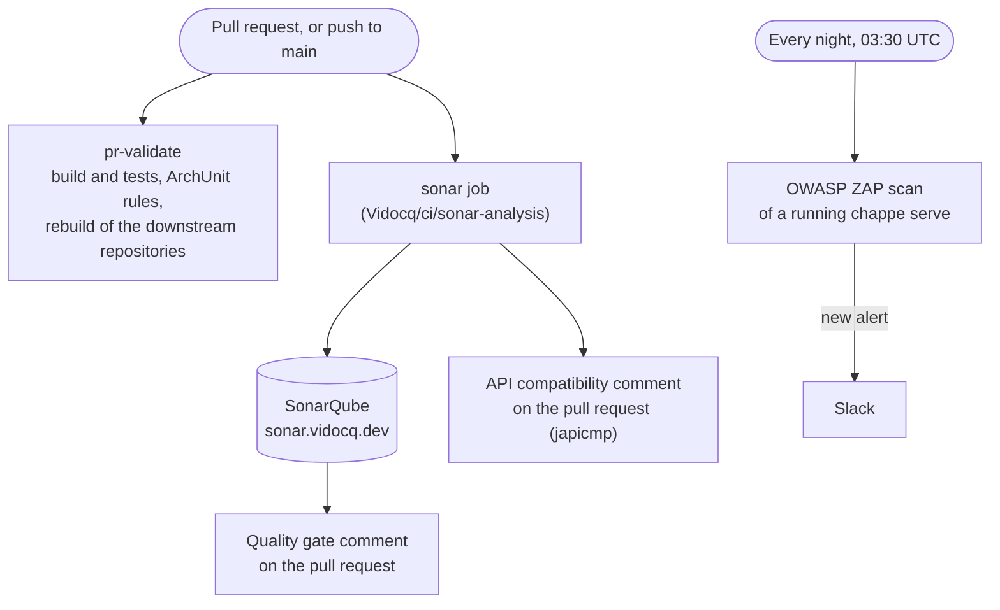
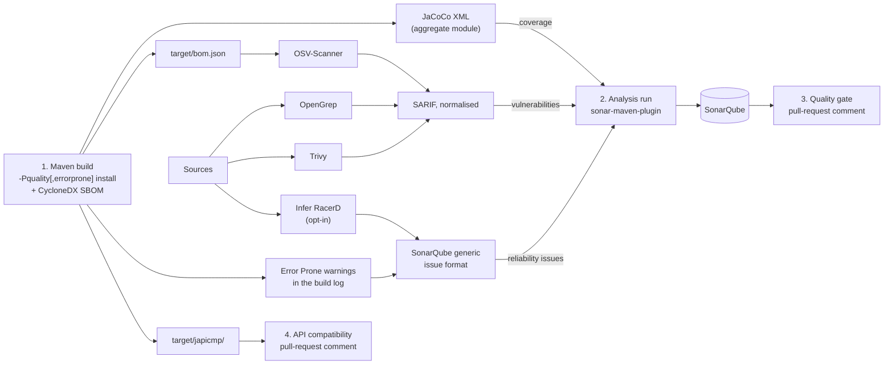

# Code quality in the Vidocq ecosystem

How the code of the Vidocq repositories is measured: the SonarQube server, the shared CI action that
feeds it, the tools plugged into that action, and their settings. The repositories hold the settings
themselves; this page explains them and links to them.

State on **2026-10-22**. The plan behind the tools is [Vidocq/vidocq#269](https://codefloe.com/Vidocq/vidocq/issues/269),
the SonarQube rollout [#284](https://codefloe.com/Vidocq/vidocq/issues/284), and the clean-up of the
findings [#285](https://codefloe.com/Vidocq/vidocq/issues/285).

## At a glance

Every change goes through the same checks, plus a nightly scan where it is in place:



- **pr-validate** is the test gate: it is a required check, and the ArchUnit rules run inside the test suite.
- The **sonar job** reports and does not block (report mode, see [Report mode and blocking mode](#report-mode-and-blocking-mode)).
- The **nightly ZAP scan** runs on Chappe only for now.

## The SonarQube server

| | |
|---|---|
| URL | <https://sonar.vidocq.dev> |
| Edition | SonarQube Community Build 26.5 with the [community branch plugin](https://github.com/mc1arke/sonarqube-community-branch-plugin): `main` and pull requests are analysed separately |
| Sign-in | Codefloe account; members of the Vidocq organisation's Owners and devs teams. Owners administer the server |
| Projects | one per repository, key `vidocq-<repository>`, created by its first analysis |
| Quality profile | built-in **Sonar way**, for every language (Java: SonarJava 8.29) |
| Quality gate | built-in **Sonar way**, on new code: no new issue, coverage of new code ≥ 80 %, duplicated lines in new code ≤ 3 %, every new security hotspot reviewed |
| New code | since the previous version (instance default): every analysis of a `-SNAPSHOT` carries the same version, so new code is everything changed since the version last changed |

A pull request gets its own analysis and its own quality gate, computed on the lines it changes.

### Report mode and blocking mode

The action runs in **report mode** by default (`blocking: false`): the job never fails on a finding, and the
pull request gets one comment, kept up to date, with the quality gate. **A red gate does not stop a merge: read
the comment before merging.** `blocking: 'true'` fails the job when the analysis fails or the gate is not
passed; each repository moves to it once its backlog is clean, decided repository by repository (#284, #285).

### Issues that are not defects

Fix first. An issue that is not a defect is resolved in SonarQube (*Accept* or *False positive*) with a comment
that says why; security hotspots are reviewed the same way (for example Chappe's MD5 for ETags and SHA-1, which
RFC 6455 requires). A rule that does not apply to a whole part of a repository is turned off there with
`sonar.issue.ignore.multicriteria` in the root `pom.xml`: Chappe ignores `java:S106` (standard output) in
`chappe-cli` and `chappe-examples`, whose job is to print.

## The analysis job: `Vidocq/ci/sonar-analysis`

One composite action, [`sonar-analysis`](https://codefloe.com/Vidocq/ci/src/branch/main/sonar-analysis/action.yml)
in the public [Vidocq/ci](https://codefloe.com/Vidocq/ci) repository, does everything, so every repository
carries the same small workflow:



1. **Build**: `maven-args`, plus `cyclonedx-maven-plugin:makeAggregateBom`. It installs the modules into the
   job's local repository, so that the separate analysis run resolves them. A failing test does not stop the
   analysis: pull-request validation is the test gate, and JaCoCo slows timing-sensitive tests down.
2. **Security scans**, **Error Prone** and **Infer** turn their findings into reports SonarQube imports as
   external issues; then the **analysis run** (`analysis-args`, no lifecycle phase) sends everything to the server.
3. **Quality gate**: the action waits for the server, reads the gate and keeps one pull-request comment up to
   date (marker `<!-- vidocq-sonarqube -->`).
4. **API compatibility**: a module whose build runs japicmp gets its summary in the log and in another comment
   (marker `<!-- vidocq-japicmp -->`).

A pull request from a fork receives no secrets: the analysis is skipped.

### Inputs

| Input | Default | Purpose |
|---|---|---|
| `sonar-token` | (required) | `secrets.SONAR_TOKEN`, organisation secret |
| `host-url` | (required) | `vars.SONAR_HOST_URL`, organisation variable |
| `project-key` | `vidocq-<repository>` | created on the server when missing |
| `bot-token` | empty | `secrets.VIDOCQ_BOT_TOKEN`: posts the pull-request comments; none when empty |
| `maven-args` | `-B -ntp -Pquality -Dmaven.test.failure.ignore=true install` | the build; add `errorprone` to the profiles for Error Prone |
| `analysis-args` | `-B -ntp -Pquality` | the analysis run, same profiles |
| `cyclonedx-version` | `2.9.3` | cyclonedx-maven-plugin |
| `scanner-version` | `5.8.0.7211` | sonar-maven-plugin |
| `blocking` | `false` | see [Report mode and blocking mode](#report-mode-and-blocking-mode) |
| `security-scans` | `true` | OSV-Scanner, OpenGrep, Trivy |
| `infer` | `false` | Infer's RacerD; opt-in, as it downloads 276 MB per run |

### The workflow of a repository

`.forgejo/workflows/sonar.yml`, the same in every repository (Chappe adds the two commented inputs):

```yaml
name: sonar
on:
  push:
    branches: [main]
  pull_request:
    branches: [main]
  workflow_dispatch:   # analyses main again, e.g. after an analysis the server could not take

jobs:
  sonar:
    if: github.event_name != 'workflow_dispatch' || github.ref == 'refs/heads/main'
    runs-on: vidocq-runner
    steps:
      - uses: actions/checkout@v4
        with:
          fetch-depth: 0   # whole history: new-code detection and blame
      - uses: https://codefloe.com/Vidocq/ci/setup-maven@main
      - uses: https://codefloe.com/Vidocq/ci/sonar-analysis@main
        with:
          sonar-token: ${{ secrets.SONAR_TOKEN }}
          host-url: ${{ vars.SONAR_HOST_URL }}
          bot-token: ${{ secrets.VIDOCQ_BOT_TOKEN }}
          # maven-args: -B -ntp -Pquality,errorprone -Dmaven.test.failure.ignore=true install
          # infer: 'true'
```

The job image of the shared runners is `node:24.22.1-trixie` (glibc 2.41; Infer needs 2.38 or later).

## The tools

| Tool | Version | Finds | Runs in | Shows up as |
|---|---|---|---|---|
| SonarQube's analysers (SonarJava…) | Community Build 26.5 | bugs, code smells, security hotspots, duplication | every analysed repository | issues of the *Sonar way* profile |
| [JaCoCo](https://www.jacoco.org/jacoco/) | 0.8.13 | line and branch coverage | every analysed repository | coverage |
| [CycloneDX Maven plugin](https://github.com/CycloneDX/cyclonedx-maven-plugin) | 2.9.3 | the SBOM of what the build ships | every analysed repository | input of OSV-Scanner |
| [OSV-Scanner](https://github.com/google/osv-scanner) | 2.6.0 | known vulnerabilities in the shipped dependencies | every analysed repository | vulnerabilities, on the root `pom.xml` |
| [OpenGrep](https://github.com/opengrep/opengrep) + opengrep-rules | 1.30.1, rules at `f1d2b562` | security patterns in the main Java sources | every analysed repository | vulnerabilities |
| [Trivy](https://github.com/aquasecurity/trivy) | 0.75.0 | leaked secrets, Dockerfile misconfigurations | every analysed repository | vulnerabilities |
| [Error Prone](https://errorprone.info/) | 2.50.0 | bug patterns, at compile time | Chappe, Foy | reliability issues, medium |
| [Infer](https://fbinfer.com/) (RacerD) | 1.3.0 | data races | Chappe, Foy | reliability issues, high |
| [japicmp](https://siom79.github.io/japicmp/) | 0.26.3 | incompatible changes against the last release | Chappe, Foy | a pull-request comment |
| [ArchUnit](https://www.archunit.org/) | 1.5.1 | breaches of the architecture rules | Chappe's and Foy's test suites | a failing build |
| [OWASP ZAP](https://www.zaproxy.org/) | 2.17.0 | vulnerabilities of the running server | Chappe, nightly | a red nightly, Slack |

Every downloaded tool is a release at least two weeks old when it was chosen, checked by SHA-256 before it runs.

### SonarQube's analysers

- The built-in *Sonar way* profile, unchanged.
- `vidocq-parent` excludes generated code: `sonar.exclusions=**/generated-sources/**,**/generated/**`. A
  repository that sets its own `sonar.exclusions` keeps these patterns.

### JaCoCo: coverage

- The `quality` profile of `vidocq-parent` runs `jacoco-maven-plugin` 0.8.13: `prepare-agent`, then `report`
  in `verify`.
- `vidocq-parent` declares an empty `<argLine></argLine>`. A module that needs JVM options for its tests writes
  `<argLine>@{argLine} its options</argLine>`: a plain `<argLine>` drops the JaCoCo agent, and the module shows
  0 % coverage.
- Each analysed repository has a `<prefix>-coverage` module, under its own `quality` profile, that runs `report-aggregate`:
  tests in one module that exercise another (`chappe-tests`, `chappe-conformance`…) count. Production modules
  are `compile` dependencies of it, test-only modules `test` dependencies. The root `pom.xml` points SonarQube at
  the aggregate:
  `sonar.coverage.jacoco.xmlReportPaths=${maven.multiModuleProjectDirectory}/<prefix>-coverage/target/site/jacoco-aggregate/jacoco.xml`.
- Benchmarks and test vehicles carry `sonar.skip=true`; examples are analysed but left out of coverage
  (`sonar.coverage.exclusions`).
- `vidocq` also lists `target/site/jacoco/jacoco.xml`: the applications `vidocq create` generates inherit
  `vidocq-runtime-parent` and have no aggregate module.

### Security scans: OSV-Scanner, OpenGrep, Trivy

Between the build and the analysis ([`security-scans.sh`](https://codefloe.com/Vidocq/ci/src/branch/main/sonar-analysis/security-scans.sh)).
None of them sends a request to Maven Central.

- **OSV-Scanner** reads the CycloneDX SBOM the build wrote (`target/bom.json`): only what the build ships, test
  dependencies left out.
- **OpenGrep** runs the community [opengrep-rules](https://github.com/opengrep/opengrep-rules) at a pinned commit,
  only the families that match the stack: `java/lang`, `java/jax-rs`, `java/servlets`, `java/java-jwt`,
  `java/jjwt`, `java/rmi`; test sources and `target/` left out. The rules are LGPL-2.1 with the Commons Clause:
  scanning our own code is fine, selling the rules is not.
- **Trivy** looks for secrets and misconfigurations (`--scanners secret,misconfig`), offline
  (`--offline-scan --skip-db-update --skip-check-update`); its dependency scan would duplicate OSV-Scanner.
- [`normalize-sarif.py`](https://codefloe.com/Vidocq/ci/src/branch/main/sonar-analysis/normalize-sarif.py) makes
  the paths relative, moves OSV-Scanner's findings to the root `pom.xml` (SonarQube does not index the SBOM),
  gives OpenGrep's rules stable ids, and drops the findings of modules SonarQube does not analyse (`sonar.skip`,
  out-of-reactor TCK runners).
- SonarQube imports the reports through `sonar.sarifReportPaths`: **every SARIF result becomes a vulnerability**.
- A scan that cannot be downloaded or fails is reported and skipped; it never stops the analysis.

### Error Prone (Chappe, Foy)

- The root `pom.xml` has an `errorprone` profile: `maven-compiler-plugin` with `-XDcompilePolicy=simple`,
  `--should-stop=ifError=FLOW` and
  `-Xplugin:ErrorProne -XepAllErrorsAsWarnings -XepExcludedPaths:.*(generated|generated-sources)/.* -XepDisableWarningsInGeneratedCode`,
  `error_prone_core` 2.50.0 on the annotation processor path. Every finding is a warning: none breaks the build.
- `.mvn/jvm.config` opens the javac internals Error Prone needs on Java 25, one line per package
  (`--add-exports=jdk.compiler/com.sun.tools.javac.<package>=ALL-UNNAMED`).
- The action finds the warnings in the build log ([`errorprone-sarif.py`](https://codefloe.com/Vidocq/ci/src/branch/main/sonar-analysis/errorprone-sarif.py))
  and imports them through **SonarQube's generic format** as reliability issues of medium severity
  ([`sarif-to-generic.py`](https://codefloe.com/Vidocq/ci/src/branch/main/sonar-analysis/sarif-to-generic.py)),
  not through SARIF, which would make them vulnerabilities. Rule keys read `external_error-prone:<Check>`.
- A module that sets its own `annotationProcessorPaths` would drop Error Prone's: the profile declares its
  path with `combine.children="append"` (Foy's `foy-cdi-vauban` keeps Vauban's processor that way).

### Infer's RacerD (Chappe, Foy)

- `infer: 'true'` in the workflow ([`infer.sh`](https://codefloe.com/Vidocq/ci/src/branch/main/sonar-analysis/infer.sh)).
- Infer's Maven integration recompiles with `-source 11`, which Java 25 code refuses: the script runs javac
  under Infer module by module (main sources, the module's class path from `maven-dependency-plugin:build-classpath`),
  then one `--racerd-only` analysis over every capture. A module whose capture fails is reported and skipped.
- Its findings become reliability issues of high severity, through the generic format.
- Infer's Linux binary needs glibc 2.38 or later: hence the trixie job image.

### japicmp: API compatibility (Chappe, Foy)

- In the `quality` profile: `japicmp-maven-plugin` 0.26.3, goal `cmp`, against the last release
  (`oldVersionPattern` `\d+\.\d+\.\d+`), `onlyModified`, `ignoreMissingOldVersion`, and no build break until
  1.0.0-RC1 makes it a gate ([#288](https://codefloe.com/Vidocq/vidocq/issues/288)).
- `japicmp.skip` is `true` at the root. Each module that publishes an API sets it to `false` and lists its exported
  packages in `<includes>`, one by one, since an include matches its package only: `chappe-api`, `chappe-http`,
  `chappe-core`; `foy-api`, `foy-chappe`, `foy-cdi-vauban` (`foy-core` exports internal packages only).
- A pull-request comment rather than SonarQube issues: SonarQube shows a pull request's issues on its changed
  lines only, and a removed method has no line left.

### ArchUnit: architecture rules (Chappe, Foy)

- `com.tngtech.archunit:archunit` 1.5.1, test scope of `chappe-tests` only: the second test-scope exception to
  Chappe's zero-dependency rule, after JUnit ([#289](https://codefloe.com/Vidocq/vidocq/issues/289)). Its core runs
  from plain JUnit tests; its JUnit engine is not used.
- [`ArchitectureRules`](https://codefloe.com/Vidocq/chappe/src/branch/main/chappe-tests/src/test/java/io/vidocq/chappe/tests/architecture/ArchitectureRules.java):

  | Rule | Forbids |
  |---|---|
  | `JDK_ONLY` | any dependency outside the JDK and Chappe |
  | `NO_REFLECTION` | `java.lang.reflect`, `Class.forName`, `getDeclared*` and the like |
  | `NO_PLATFORM_THREADS` | thread pools, `ThreadPoolExecutor`, `ForkJoinPool`, `Thread.ofPlatform()`, `new Thread()` |
  | `NO_THREAD_LOCAL` | `ThreadLocal`, which caches nothing across virtual threads |
  | `LAYERS` | `chappe-api` reaching into `chappe-http` or `chappe-core`, `chappe-http` into `chappe-core` |

- `ArchitectureRulesTest` applies them to the shipped classes, after checking that the import found them;
  `ArchitectureRulesSelfTest` shows each rule failing on a fixture that breaks it. No baseline of accepted violations.
- Foy keeps its rules in a test-only module, [`foy-architecture-tests`](https://codefloe.com/Vidocq/foy/src/branch/main/foy-architecture-tests):
  the dependencies allowed to each shipped module (Chappe only through `chappe-api`, Vauban only in
  `foy-cdi-vauban`), the layers of the `module-info.java` files, no reflection outside the four documented
  fallbacks, no platform threads (an executor given a virtual-thread factory is allowed), no `ThreadLocal`.

### OWASP ZAP: nightly scan (Chappe)

- [`zap-nightly.yml`](https://codefloe.com/Vidocq/chappe/src/branch/main/.forgejo/workflows/zap-nightly.yml),
  every night at 03:30 UTC and on demand ([#273](https://codefloe.com/Vidocq/vidocq/issues/273)): it builds
  Chappe, starts `chappe serve` on a small site (`etc/zap/`) and runs ZAP's automation plan `etc/zap/plan.yaml`:
  spider (2 min), passive rules (up to 5 min), active scan (up to 2 min per rule, 15 min in all), JSON report.
- `etc/zap/check.py` compares the alerts with `etc/zap/accepted.tsv`: an alert of risk Low or above that is not
  accepted fails the night; informational alerts never do. The list is empty: since chappe#49 the `Server` header
  no longer gives the version, and a version coming back would fail the night.
- Slack hears of failures on `main` only.

## Where each tool runs

| Repositories | SonarQube, JaCoCo, security scans | Error Prone | Infer | japicmp | ArchUnit | ZAP |
|---|---|---|---|---|---|---|
| chappe | ✓ | ✓ | ✓ | ✓ | ✓ | ✓ |
| foy | ✓ | ✓ | ✓ | ✓ | ✓ | in progress |
| cassini, cervantes, champollion, cyrano, dirac, grimm, heisenberg, humboldt, ibarra, knock, mansart, peano, ravel, tassis, vauban, verne, vidocq | ✓ | | | | | |
| noether | pull request waiting ([noether#40](https://codefloe.com/Vidocq/noether/pulls/40)) | | | | | |

Not analysed: `erasmus` (not wired yet), `vidocq-parent` (a POM), the sites
(`pages`, `vidocq-docs`) and the repositories without a Java build.

Chappe was the pilot; Foy followed on 2026-10-22, once Chappe's quality gate was green. The other repositories
follow one by one (#269), each findings backlog going to the clean-up campaign (#285).

## Reading the results

- **On a pull request**: the SonarQube comment (gate, new issues, coverage of new code, link to the analysis),
  and the japicmp comment where japicmp runs. In report mode the gate does not block: read it before merging.
- **On `main`**: `https://sonar.vidocq.dev/dashboard?id=vidocq-<repository>`. An analysis the server could not
  take leaves a green job behind: check that the last analysis is the head of `main`
  (*Project Activity*), and run the workflow by hand on `main` otherwise.
- **Nightly ZAP**: Slack on failure; the log of the run lists every alert.
- **In the IDE**: SonarQube for IDE binds to the server with a personal token (*My Account → Security*).
- **Locally**, from a repository checkout:

  ```bash
  ./mvnw -Pquality verify                 # tests with coverage: <prefix>-coverage/target/site/jacoco-aggregate/index.html
  ./mvnw -Pquality,errorprone install     # Chappe: Error Prone's warnings in the log, japicmp in target/japicmp/
  ```

## Adding a repository

1. Copy `.forgejo/workflows/sonar.yml` from a repository that has it. The first analysis creates the SonarQube
   project.
2. In the root `pom.xml`: a `<prefix>-coverage` module under the `quality` profile, running `report-aggregate`;
   `sonar.coverage.jacoco.xmlReportPaths` pointing at its report; `@{argLine}` at the start of every surefire or
   failsafe `<argLine>`; `sonar.skip=true` in benchmarks and test vehicles; examples in `sonar.coverage.exclusions`.
3. Check locally that `./mvnw -Pquality verify` writes the aggregate report with the expected coverage, then open
   the pull request: its SonarQube comment is the proof the wiring works.
4. Later, as on Chappe: an `errorprone` profile with `.mvn/jvm.config` and `-Pquality,errorprone` in `maven-args`;
   japicmp in the `quality` profile with the exported packages; `infer: 'true'`.

## Pitfalls met so far

- **SARIF means vulnerability.** A SARIF import counts every result as a vulnerability: right for the security
  scans, wrong for a code checker. Error Prone and Infer go through the generic format.
- **The generic format works module by module** and resolves relative paths per module: give it absolute paths.
- **A finding SonarQube cannot place is pinned on the whole project** instead of being dropped: filter before the
  import (`normalize-sarif.py`).
- **A scanner must never resolve Maven dependencies itself**: during the trial, OSV-Scanner's source scan and
  Trivy's dependency scan got a runner's address rate-limited by Maven Central (HTTP 429, blocked for 30 minutes).
- **Report mode hides a failed analysis**: the job stays green and no comment appears. Look for the comment, and on
  `main` for an analysis of the head commit.
- **A plain surefire `<argLine>` drops the JaCoCo agent**: write `@{argLine}` first.
- **Two checkers can disagree.** Error Prone's `BooleanLiteral` suggests `assertEquals(true, x)`, which SonarJava's
  `java:S2701` forbids: write `assertTrue(x)`.
- **Text blocks and CRLF**: end each line with `\r`; SonarJava's `java:S5665` does not flag that escape.
- **Fixing a finding must not change what the code writes**: when a fix touches bytes on the wire (a header turned
  into a text block), compare the constants with `javap`, or pin the output in a test first.

## Decisions

- **SpotBugs** and **Dependency-Track**: not added, they duplicate SonarJava and OSV-Scanner (2026-10-21).
- **NullAway**: set aside. It needs nullness annotations, and JSpecify would add a dependency to what the bricks
  ship; a Vidocq-owned `@Nullable` remains possible later (2026-10-21).
- **ArchUnit**: allowed in Chappe's test scope, never shipped (2026-10-22).
- **Blocking mode**: decided repository by repository, once its findings are cleaned up (#284, #285).
