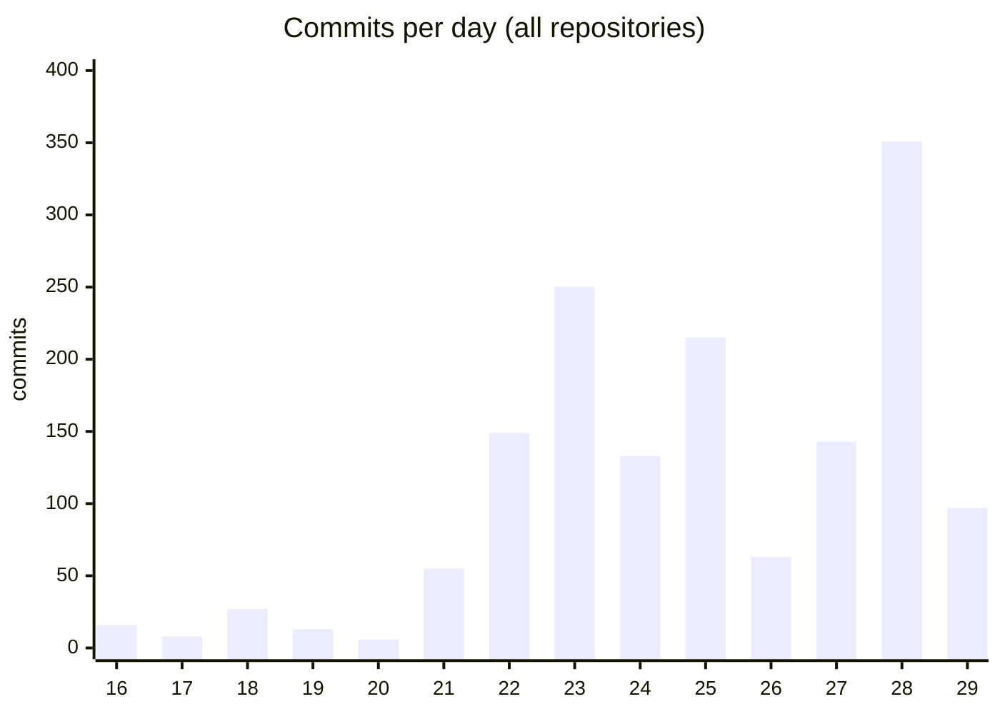
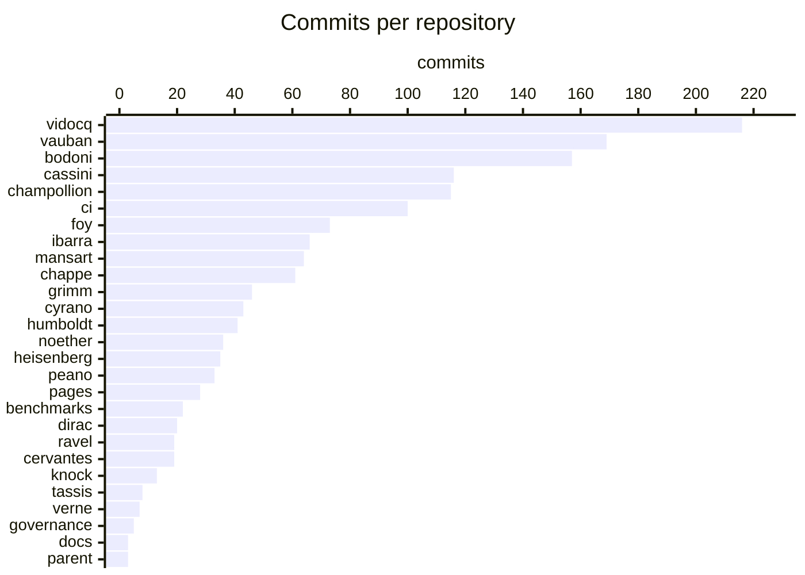
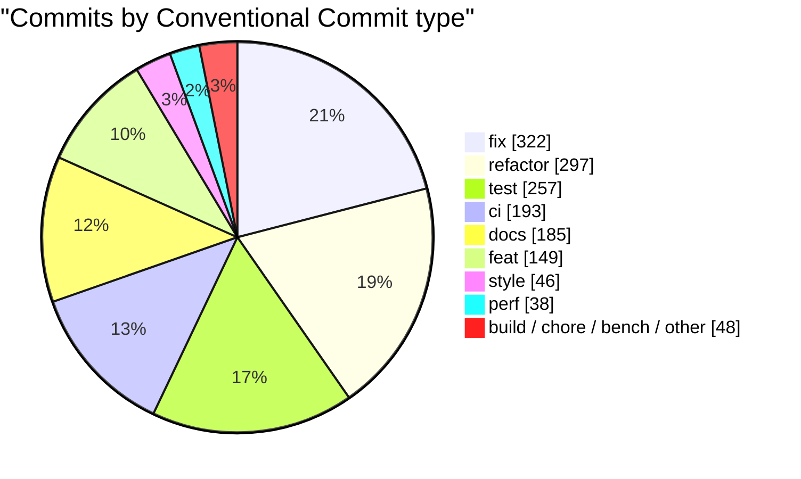
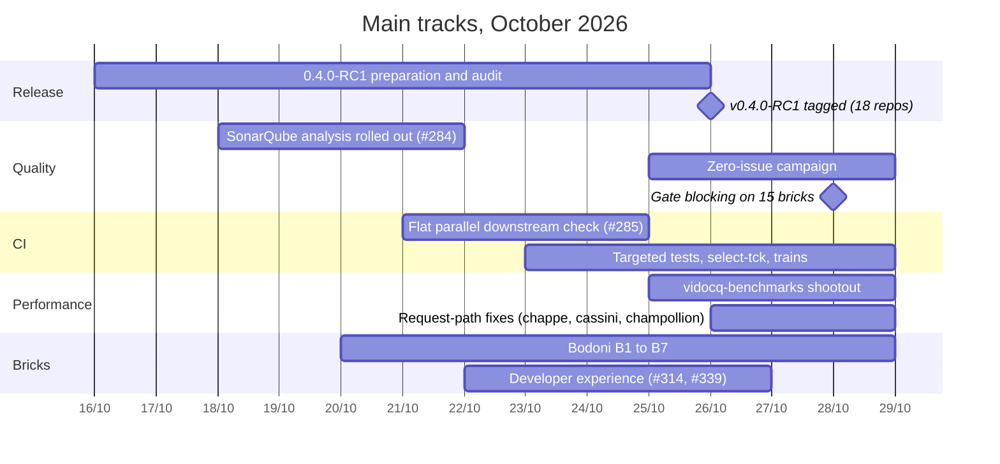
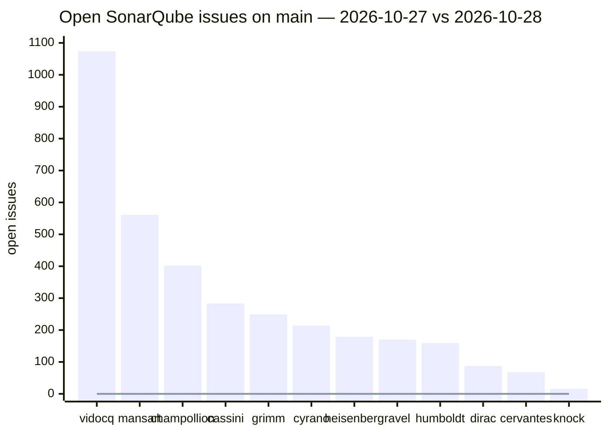
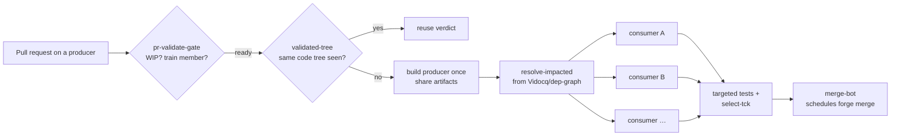
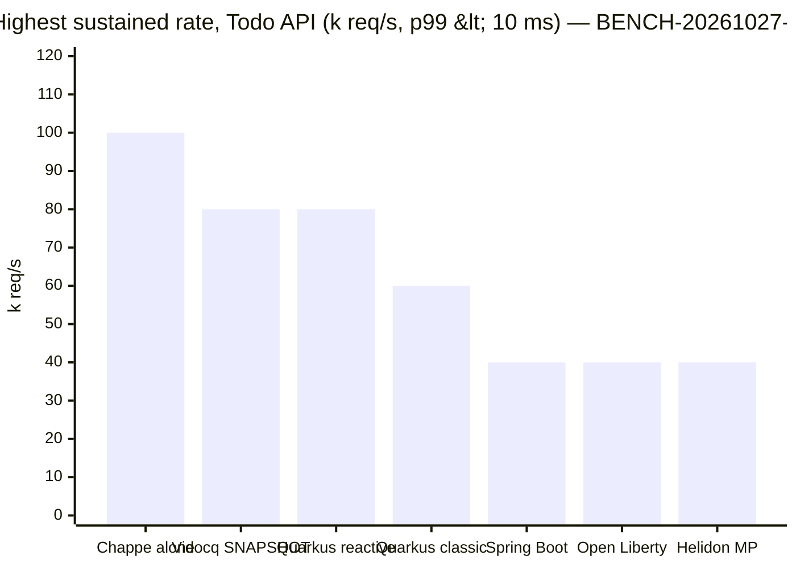
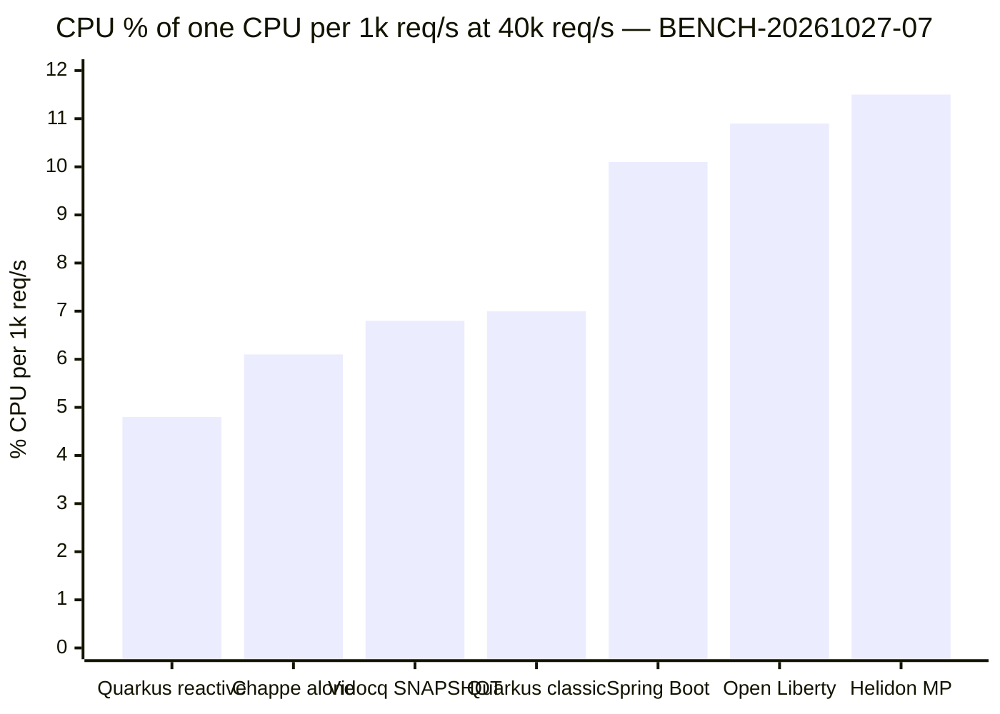
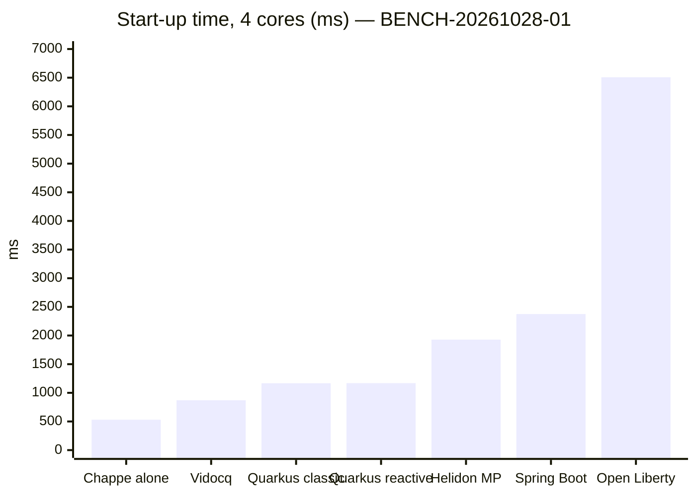

# Two weeks of Vidocq — 2026-10-15 to 2026-10-29

Summary of the work merged on `origin/main` of every repository of the ecosystem between
2026-10-15 and 2026-10-29 (fetched on 2026-10-29). Figures come from `git log --no-merges`;
performance figures point to their `BENCH.md` entry, SonarQube figures to `OPTIMS.md`.

## In one paragraph

The fortnight shipped **Vidocq 0.4.0-RC1** (tagged on 2026-10-26 in 18 repositories), then
moved every line to 0.4.0-SNAPSHOT. Around the release, four tracks ran in parallel: a
**SonarQube campaign** that took fifteen bricks to zero open issue and made the gate blocking;
a **CI rework** (Vidocq/vidocq#285) that checks downstream consumers in parallel, replays only
the tests and TCKs a pull request reaches, and merges through PR trains; a **performance pass**
on the request path, driven by a new cross-runtime benchmark repository, that roughly halved
Vidocq's CPU per request and doubled its sustained rate; and a **developer-experience push**
(CLI and Maven goals: `create`, `doctor`, IDE setup, `@VidocqTest`). A new brick, **Bodoni**
(Jakarta Standard Tag Library 3.0), went from scaffold to official TCK runner in the same window.

## Activity in numbers

| | |
|---|--:|
| Repositories with commits | 27 of 28 (+ the workspace) |
| Commits (no merges) | 1 535 |
| Lines added / removed | ≈ 312 000 / ≈ 63 000 |
| Release | v0.4.0-RC1, 18 repositories, 2026-10-26 |
| New repositories | `bodoni`, `verne`, `vidocq-benchmarks` |
| SonarQube issues closed | ≈ 3 460, fifteen bricks now at 0 |

Lines include tests, documentation and the initial commit of `vidocq-benchmarks`. Nine commits
carry an older author date (rebased work); they are counted but left out of the daily chart.

### Commits per day

The quiet start (16–20) is the RC1 preparation; the peaks of 23 and 25 are the CI rework and
the release audit, the peak of 28 is the Sonar campaign on the MicroProfile and Data bricks.

### Commits per repository

`erasmus` had no commit in the window.

### Kind of work

Fixes and refactors dominate: most of the fortnight was hardening (Sonar, coverage, spec
contract fixes) rather than new surface.

## Timeline of the main tracks

## 1. Release 0.4.0-RC1

- Tagged on 2026-10-26 in `vidocq`, `vidocq-parent`, `vauban`, `chappe`, `champollion`,
  `cassini`, `foy`, `mansart`, `peano`, `ibarra`, and the MicroProfile bricks (`ravel`, `knock`,
  `dirac`, `heisenberg`, `cervantes`, `cyrano`, `humboldt`, `grimm`). Bodoni was added to the
  runtime's Web Profile documentation as of 0.4.0-RC1 (vidocq#266).
- `vidocq-docs` publishes the 0.4.0-RC1 line (retention: last three releases + dev) and can now
  cut a release candidate.
- `ci`'s `release-maven` was hardened along the way: modules with `maven.deploy.skip` are
  excluded consistently, internal `<parent>` versions are realigned after `versions:set`, and a
  project can block its own release.
- `pages`: the 0.4.0-RC1 release post (co-signed by Antoine Sabot-Durand), the developer-joy
  post with real `create` / `doctor` / `extension add` outputs, and a post on the OpenTelemetry
  `tracestate` advisory.

## 2. Code quality — the SonarQube campaign

SonarQube (community branch plugin, `sonar.vidocq.dev`) was rolled out to every Java repository
with an aggregated JaCoCo report (vidocq#284), then a cleanup ran brick by brick: reliability
and security first, then smells, then coverage. Since 2026-10-28 the check is **blocking** on
the fifteen bricks of the Jakarta EE Core, MicroProfile and Data scope.

Bars: 2026-10-27 snapshot; line: 2026-10-28 evening (all at 0, ratings A / A / A / A).
`chappe`, `vauban`, `foy`, `bodoni` and `verne` were already at 0. Coverage now ranges from
82 % (knock) to 95.6 % (grimm). Left for later: `noether` (1 187), `ibarra` (504), `tassis`
(350), `peano` (197). Details and method: `OPTIMS.md`.

Other quality and security tooling added to the shared Sonar action (`QUALITY.md`): Infer's
RacerD (opt-in), japicmp API compatibility report, Trivy scoped to shipped modules, an SBOM of
shipped dependencies, Error Prone and ArchUnit (Foy pilot), a nightly ZAP scan on Foy. Security
fixes: OpenTelemetry 1.67.0 for GHSA-ccrj-gw8r-854m (vidocq, humboldt), the compromised eMudhra
intermediate CAs blocked through a Maven-only trust store (vidocq#292), and a first threat model
with the external audit scope (vidocq#276, #278).

## 3. CI — Vidocq/vidocq#285 and Vidocq/ci#57

The producer's `pr-validate` used to rebuild consumers in a chain. It now:

- **Flat parallel downstream check**: `resolve-impacted` + `build-one-consumer`, one job per
  transitive consumer, upstream versions pinned in one pass, stale dependency graph fails the
  build; consumers built on their **companion branch** when one exists
  (`docs/changes-across-repositories.md`).
- **Shared producer artifacts**: the producer is built once and handed to the downstream jobs.
- **Targeted tests**: only the consumer and producer tests that can see a changed artifact run;
  `select-tck` replays only the TCK runners a pull request reaches; an opt-in baseline on failure
  tells a new failure from an existing one.
- **Validated tree** (ci#57): a pull request whose code tree was already validated reuses the
  verdict; docs-only and CI-only pull requests skip the build and the downstream rebuild.
- **Gating and merging**: WIP gating, **PR trains** (`train-merge.py` lands a train through its
  validated top), and a merge-bot that schedules the merge with the forge instead of polling.
- **Main builds** in one pass (build, test, TCK, deploy), queued, SNAPSHOTs deployed in one batch
  at the end of the reactor; Slack alert when `main` turns red.
- **Official TCKs gate pull requests**: Jakarta REST 4.0 (cassini), JSON-P 2.1 and JSON-B 3.0
  (champollion), Tags 3.0 smoke (bodoni).
- **Bench window**: the benchmark machine stops both CI runners and starts the bench runner
  through Portainer (ADR 0001 and follow-ups in `docs/adr/`).

## 4. Performance

`vidocq-benchmarks` (new repository, 22 commits) runs a Todo API on six stacks with wrk2 on a
dedicated machine, plus start-up/footprint and JSON suites. The first run
(BENCH-20261026-01) put Vidocq 0.4.0-RC1 last on CPU; a JFR analysis per brick drove the fixes:

- **chappe**: one watchdog virtual thread per connection, body drained without a buffer, one
  blocking read per keep-alive request.
- **cassini**: request-path caches (no `ClassNotFoundException` per request, pre-matching
  filters once, base URI and media-type caches, verb-first router), inline dispatch on the
  connection's virtual thread, per-method metadata, response body handed over without copies.
- **champollion**: unlocked generator buffer, static bindings below the root, UTF-8 encoded
  straight to the stream, small bodies read without an 8 KB buffer.
- **vauban** (#227): generated-code hot paths — nothing resolved again on an intercepted call,
  constructor handles looked up once, unused `_Factory` classes no longer generated, and a loud
  warning when classes are generated at run time (same warning added to cassini and cyrano).

For reference, RC1 sustained 40k req/s at 17.5 % CPU per 1k req/s (BENCH-20261026-01, 8 server
CPUs; BENCH-20261027-07 gives the server 6 CPUs, so the two runs are not strictly comparable —
the SNAPSHOT does better on fewer cores).

Start-up and footprint (BENCH-20261028-01, medians of 7 cold starts, 4 cores):

| 4 cores | Vidocq | Quarkus reactive | Quarkus classic | Helidon MP | Spring Boot | Open Liberty |
|---|--:|--:|--:|--:|--:|--:|
| RSS at rest (MB) | 127 | 155 | 154 | 210 | 262 | 490 |
| Loaded classes after traffic | 1 938 | 4 277 | 4 210 | 6 179 | 6 096 | 8 082 |
| Application size (kB) | 2 888 | 19 072 | 19 068 | 12 216 | 19 504 | 367 812 |

JSON (BENCH-20261028-02, -29-01): inside the same Chappe server the four libraries are within
4 % of each other (Champollion 6.01 % CPU per 1k req/s, Jackson 6.04, Yasson 6.27). In JMH,
Champollion writes a single todo 2.7× faster than Jackson 2, but is still behind Jackson on the
100-item list and on reading a body; the 2026-10-29 champollion commit targets exactly those two
cases (byte-stream list writer and small-body reader).

## 5. Developer experience (vidocq#314, #339 and follow-ups)

- **CLI and Maven goals side by side**: `vidocq create` / `vidocq:create` (catalog by family, a
  finished project with its Maven wrapper and a first test, no main class unless `--main`),
  `vidocq doctor` / `vidocq:doctor` with project checks and `--fix`, `add-extension` /
  `remove-extension`, `list-extensions`, `vidocq test`, `vidocq info`, update notice.
- **IDEs**: `vidocq idea`, `vidocq vscode`, `vidocq eclipse` write the project files; Eclipse
  and VS Code now run the annotation processors (Vauban processor quirks fixed: VAU-APT-004/005).
- **Testing**: `@VidocqTest` starts the application for a test class (#350).
- **Build**: an application BOM and parent separate from the reactor root (#348), no Vidocq
  version needed under the application parent; the plugin wires each extension's codegen bundle;
  `jlink` / `jpackage` without a main class; a clear error when an application was compiled
  without Vauban's processor (VIDOCQ-GEN-002).
- **New runtime extensions**: `vidocq-runtime-naming-extension` (the `java:` JNDI namespace
  backed by CDI, declared in `vidocq.properties`, on top of the new `vauban-naming`),
  `vidocq-runtime-vaadin-extension` (Vaadin app shell in a jlink image), an Ibarra extension
  serving precompiled JSP pages through Foy (the Bistro example now serves JSP pages).

## 6. Bricks

| Brick | Highlights |
|---|---|
| **bodoni** (new) | Jakarta Standard Tag Library 3.0 from scaffold to B7: `c:`/`fn:` (B1), `fmt:` with resource bundles under Java Modules (B2), `x:` with hardened JAXP and same-origin external references (B3), `sql:` with credential redaction (B4), official Tags TCK runner and smoke check on PRs (B5), inlining measured and put on standby (B6), Open Liberty portability proof (B7). |
| **vauban** | Declared `java:` names in four namespaces (`vauban-naming`); a batch of CDI fixes (vauban#187–#210: intercepted beans' creational contexts, synthetic observers, build compatible extensions); #227 generated-code dedupe and hot-path perf; studies of CDI 4.1 Full and CDI 5. |
| **cassini** | Request-path performance; client API contract fixes; CASSINI-026…032 (multipart, `EntityPart`, `UriInfo`, `SseBroadcaster`, `UriBuilder` encoding). |
| **champollion** | Perf (above); JSON-B fixes (visibility strategies, type variables, `@JsonbNillable`, subtypes); protobuf enum/unsigned/well-known-type fixes. |
| **chappe** | Perf (above); HTTP/2 `:authority`, Huffman padding, shared buffer pool across virtual threads (CHAPPE-037), TLS handshake fix; server header without version by default (vidocq#273). |
| **foy** | Application class loader as context loader for request, async, I/O and cross-context work (BUG-20261022-06); UTF-8 default response encoding, `SameSite=Lax` session cookie, escaped error page (vidocq#273). |
| **ibarra** | Jakarta Pages 4.0 TCK coverage completed (IBARRA-152); Arquillian adapter published as `ibarra-arquillian`; tag-file validation fixes. |
| **peano** | Accessor tables by supertype, shared accessor catalog (EL-019), COMP-010 fix found through Bodoni's TCK. |
| **mansart** | Jakarta Data fixes MANSART-010…023 (`CrudRepository` insert/update, `@Find` with `@By`/`@OrderBy`, JDQL enums, generic repositories on the runtime path). |
| **noether** | Entity graphs loaded through SQL joins, bounded staged reads for nested collections, `@MapsId`/`@IdClass` element-collection targets, bootstrap indexing of relationship metadata. |
| **MicroProfile bricks** | ravel, knock, dirac, heisenberg, cervantes, cyrano, humboldt, grimm all reached 0 Sonar issue with ≥ 82 % coverage, with real fixes on the way (heisenberg bulkhead permits BUG-010, humboldt batch worker and flush semantics, cyrano generic super-interfaces, grimm YAML backtracking and JSON big integers). |
| **verne** (new) | Build skeleton of the template engine. |

## 7. Governance, docs and planning

- `governance`: step-by-step contributor setup, a maintainer guide, contributors need no team
  (maintainers approve the CI of fork pull requests), PR trains documented.
- Workspace: getting-started guide from a fresh machine to the first pull request,
  `QUALITY.md`, `OPTIMS.md`, `docs/changes-across-repositories.md`, ADR 0001 on performance
  testing (bench window, result storage, Kroki charts in the docs); `vidocq-docs` ADR 0005
  (shared code-generation library, not pursued).
- `vidocq/ROADMAP.md`: a release plan to **1.0.0 (production-ready) at the end of S1 2027**,
  estimates by quarter; the Web Profile follows in 1.x with CDI 4.1 Full (stages in 1.1.0 and
  1.2.0); "ship every component, certify only a few".

## What is next

From `OPTIMS.md` and the open threads at the end of the window:

1. Sonar cleanup of the remaining bricks: `noether`, `ibarra`, `tassis`, `peano`.
2. Cassini's remaining request-path copies, then a new shootout measurement.
3. Champollion's list writer and small-body reader against Jackson (re-run of bench-json).
4. The `bench-core-profile` suite (Vidocq vs Quarkus classic, three variants) just landed.
