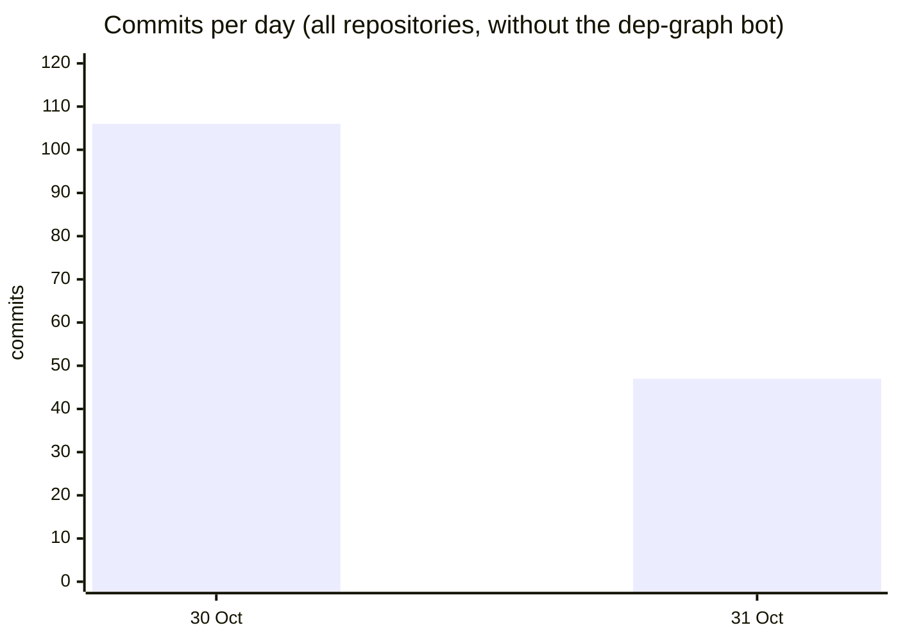
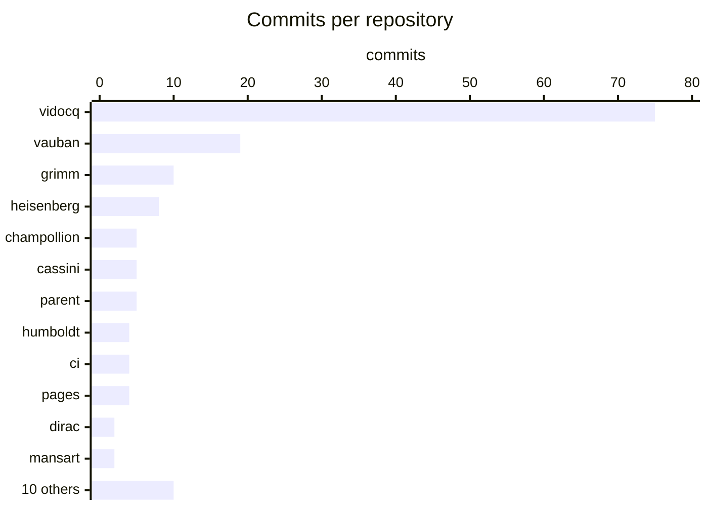
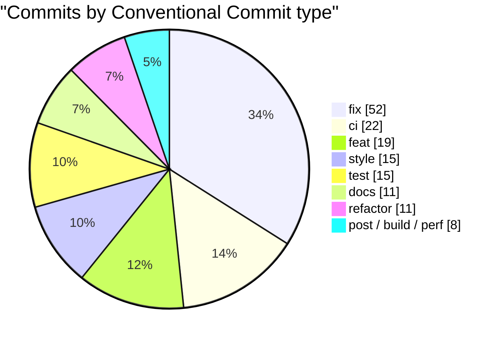
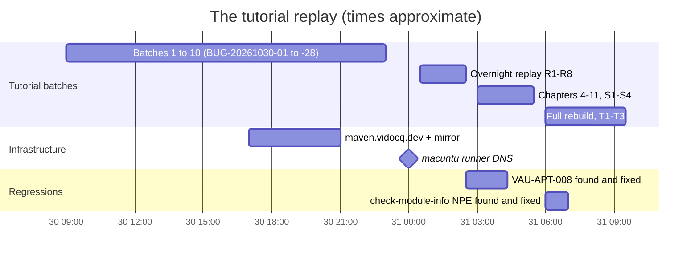
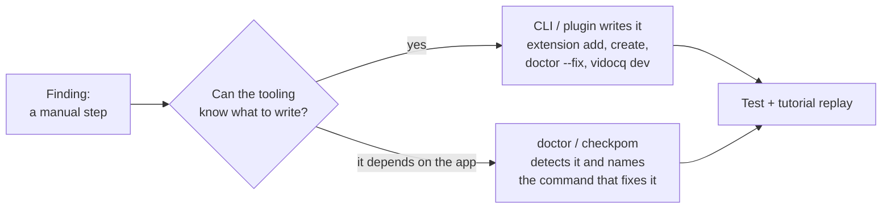
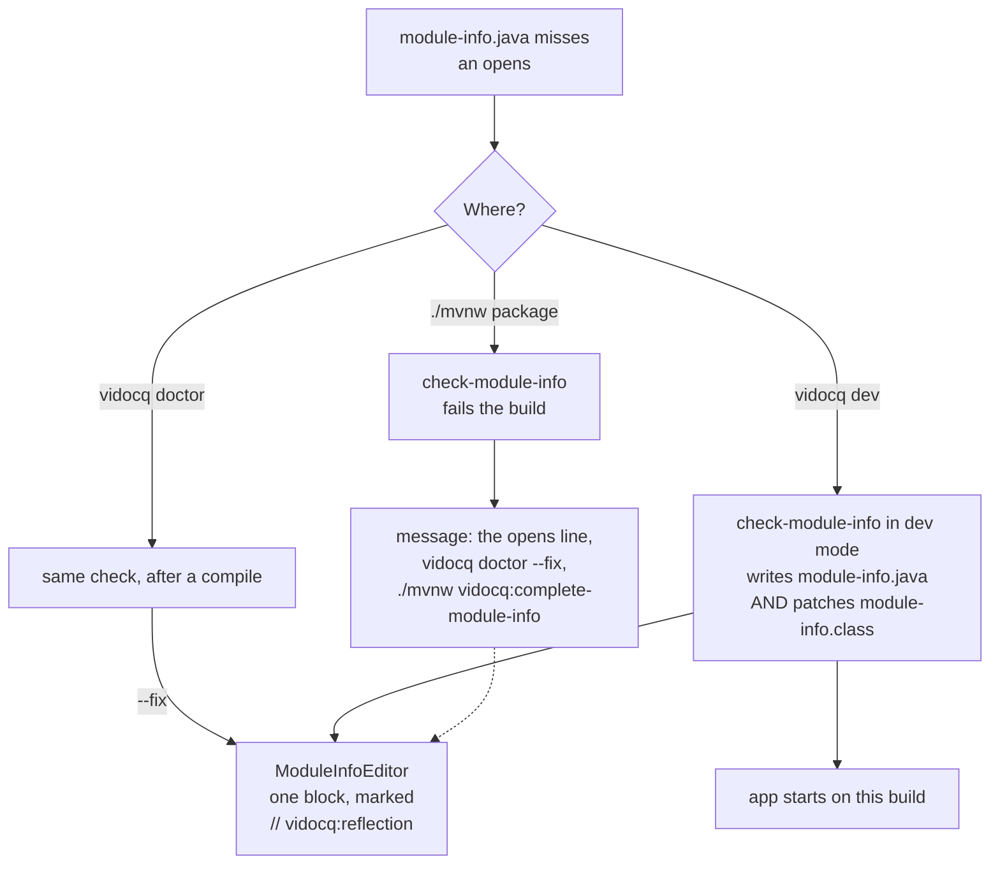
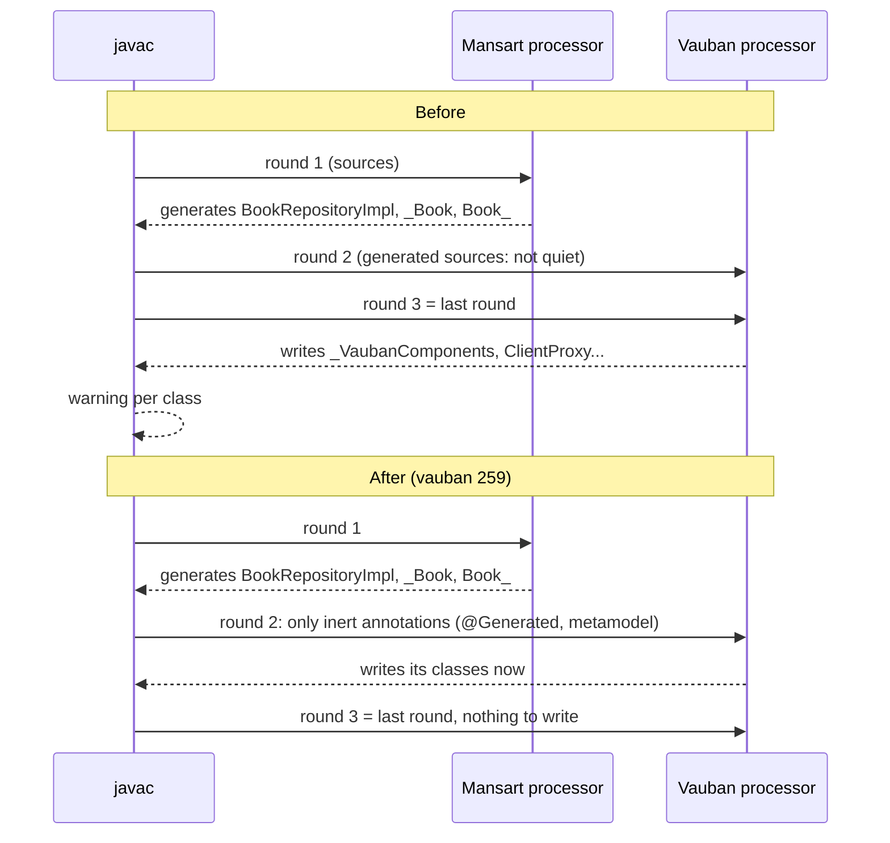
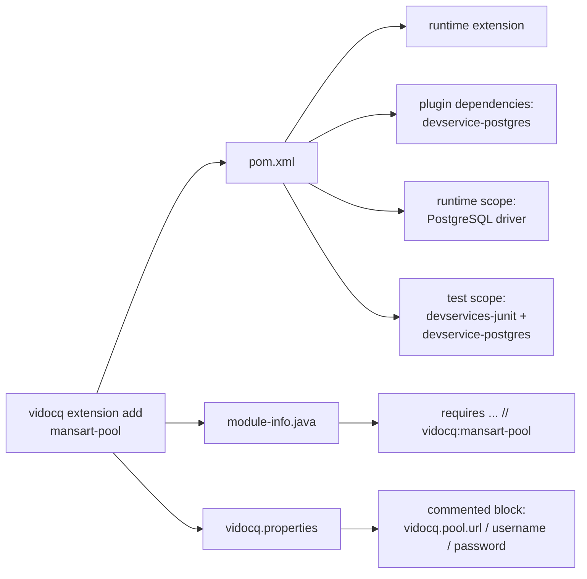
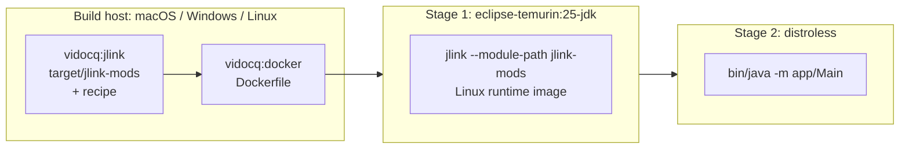

# The tutorial replay — 2026-10-30 to 2026-10-31

What changed across the ecosystem while a second Claude session (the **tutorial session**) wrote
and replayed the Vidocq tutorial (`VidocqTools/vidocq-tutorial`, eleven steps from
`vidocq create` to a Docker image) and reported every rough edge it hit. Figures come from
`git log --no-merges origin/main` of every repository, fetched on 2026-10-31 after
https://codefloe.com/Vidocq/vidocq/pulls/460 (main `56e13c56`); each fix links its pull request
and its `BUG.md` entry.

## In one paragraph

The tutorial session filed about fifty findings, in ten batches on 2026-10-30, then in three
overnight replays (R1–R8, S1–S4, T1–T3). Almost all of them had the same shape: Vidocq moved
work to the build (annotation processors, build-time extensions, generated code), and each move
left the user one more manual step — a `requires`, an `opens`, a plugin dependency, a property, a
Dockerfile. The rule set for the campaign was **compile-first must not make Vidocq harder to
use: the CLI and the Maven plugin take the build-time constraint, not the user**. The two days
therefore changed the tooling more than the runtime: `vidocq doctor` and the build now run one
and the same module check, `vidocq dev` writes a missing `opens` itself, `extension add` writes
the dev-service provider, the JDBC driver, the test block and the settings each extension needs,
and `vidocq build docker` produces a Linux image from macOS. Vauban gained build-time discovery
of dependency beans and generated interceptor invokers, which removed two classes of manual
directives. Two regressions came in on the way; the tutorial caught both within hours, and each
fix came with a test that guards the whole class of bug. On the side, SNAPSHOTs moved to our own
Maven repositories after Maven Central's monthly limits were hit.

## Activity in numbers

| | |
|---|--:|
| Repositories with commits | 22 (+ `dep-graph`, updated by its bot) |
| Commits (no merges, without the `dep-graph` bot) | 153 |
| Pull requests merged | 84 (three vidocq trains, one Vauban train) |
| Lines added / removed | ≈ 19 300 / ≈ 1 700 |
| Bug entries opened or closed (all `BUG.md`) | 63 |
| Tutorial findings | ≈ 50: all fixed, one not reproduced, one not a bug (see *Still open*) |
| SNAPSHOT repositories | `maven.vidocq.dev` (Foix) + `maven.bak.vidocq.dev` (Montreuil) |
| Official TCK after every Vauban change | CDI Lite 774/774, AtInject green |

Lines include tests and documentation. Commit dates are committer dates: rebased and train
commits count on the day they reached `main`.

### Commits per day

### Commits per repository

The "10 others" (`cervantes`, `ravel`, `knock`, `cyrano`, `chappe`, `foy`, `ibarra`, `peano`,
`tassis`, `erasmus`) each have one commit: the CI change that publishes their SNAPSHOTs to
`maven.vidocq.dev`.

### Kind of work

`style` and part of `refactor` are the SonarQube gate: every pull request of the campaign merged
with **0 new issue** (see *Quality gates*).

## Timeline

## 1. The guiding rule: compile-first stays easy to use

Vidocq generates at build time what other runtimes do by reflection at start-up. That is the
point of the project (AOT-friendly, no proxies, small start-up), but every piece of generation
has a price: a processor on the processor path, a module directive, a build phase. The tutorial
showed the price landing on the user, one manual step per chapter. The fixes below follow one
rule, applied to each finding:

What the user no longer writes by hand, as of `main` `56e13c56`:

| Before (2026-10-29) | Now |
|---|---|
| `requires jakarta.persistence`, `requires io.opentelemetry.api`… | brought by the extension (`requires transitive`) |
| `opens db.migration;` after the first migration | written by `extension add flyway-migration`, folder created |
| `opens` for each package of entities / JSON types / interceptors | written by `vidocq dev`, `doctor --fix` or `complete-module-info`; interceptors need none |
| dev-service provider in the plugin's `<dependencies>` | written by `extension add` |
| JDBC driver | written by `extension add mansart-pool` |
| `vidocq-runtime-devservices-junit` + provider in test scope | written by `extension add` |
| `otel.*`, `mp.jwt.verify.*`, `vidocq.pool.*` settings | a commented (or active) block per extension in `vidocq.properties` |
| a Dockerfile for macOS | `vidocq build docker` |
| `mvn process-classes` before `vidocq test` | done by `vidocq test` |

## 2. Java module directives — one check, written by the tooling

**Problem.** An application is a named Java module. The runtime reaches some application packages
by reflection (JSON-B binding, JPA entities, Flyway migrations, CDI interceptors), so they must be
`opens`. Before the campaign, three tools had three views: `vidocq doctor` checked the extensions'
`requires`, `vidocq:check-module-info` checked a different list, and nothing checked the
application's own packages — the first request failed with `IllegalAccessException`
(BUG-20261030-24, BUG-20261031-01, -04).

**Fix.**

- One list of directives per extension (`KnownExtensions.moduleDirectives`), the resource packages
  it reads included, shared by `doctor`, `extension add`, `create` and the build check
  (https://codefloe.com/Vidocq/vidocq/pulls/444 in train https://codefloe.com/Vidocq/vidocq/pulls/447,
  BUG-20261031-01/-03).
- `ReflectedPackages` reads the compiled classes and lists the application packages the runtime
  reaches by reflection: JPA entities, the types a REST resource takes or returns and the types
  their fields hold, interceptors (https://codefloe.com/Vidocq/vidocq/pulls/435 in train
  https://codefloe.com/Vidocq/vidocq/pulls/443, https://codefloe.com/Vidocq/vidocq/pulls/445 in
  train https://codefloe.com/Vidocq/vidocq/pulls/447). It moved to `vidocq-runtime-tooling` so
  the CLI and the plugin run the same code (https://codefloe.com/Vidocq/vidocq/pulls/449).
- Who writes the missing lines depends on where you are:

- Under `vidocq dev` the line is written in the source and in the compiled `module-info.class`
  (Class-File API), so the application starts without another compile
  (https://codefloe.com/Vidocq/vidocq/pulls/452, BUG-20261031-10).
- After a compile error, the check says the module is not compiled yet instead of claiming there
  is no `module-info.java`; messages say "Java module", not "JPMS" (BUG-20261031-02).
- **Interceptors need no `opens` any more.** Vauban called interceptor methods with
  `Method.invoke`; it now calls them through an invoker generated in the package's
  `_VaubanComponents` provider (https://codefloe.com/Vidocq/vauban/pulls/256, VAU-INT-011), and
  the check only asks for an `opens` when a called method is `private`
  (https://codefloe.com/Vidocq/vidocq/pulls/448).
- When JSON-B cannot reach a type, the error names the module, the package and the line to add
  (https://codefloe.com/Vidocq/champollion/pulls/60, champollion BUG-20261031-01).
- One layout for the file, whatever wrote it last: hand-written lines, then the extension lines
  (`// vidocq:<id>`) together, then one block of `opens … // vidocq:reflection`. Older files with
  several "added by vidocq" blocks are merged on the next write
  (https://codefloe.com/Vidocq/vidocq/pulls/460, BUG-20261031-14).

**Verified.** Unit tests on each tool, then through Maven and the real CLI on generated
applications; the tutorial's eleven steps package, and `vidocq doctor` shows ✔ Module directives.

## 3. Build-time generation in Vauban

### Dependency beans at build time (VAU-APT-006)

The processor only knew the beans of the module being compiled, so `@Inject JsonWebToken`
(produced in `cervantes-cdi-vauban`) warned "unsatisfied" at every build. The processor now reads
the bean archives on the module path and validates against their beans
(https://codefloe.com/Vidocq/vauban/pulls/252, train of 249–251; it also fixed VAU-DISC-003, an
`@Inject` constructor typed from another constructor of the same arity).

### Build-time extensions on the processor path

Several bricks run their `BuildCompatibleExtension` at build time through a codegen bundle:
Metrics (Dirac) and OpenAPI (Grimm), then JWT (Cervantes) and Fault Tolerance (Heisenberg)
(https://codefloe.com/Vidocq/vidocq/pulls/398, https://codefloe.com/Vidocq/vidocq/pulls/412,
https://codefloe.com/Vidocq/vidocq/pulls/426). The relays the JWT
and Rest Client extensions declared beside their brick's extension were removed
(https://codefloe.com/Vidocq/vidocq/pulls/423, BUG-20261030-22). A BCE on the processor path runs
twice — at build and at boot — so a synthetic bean that depends on what it saw is declared twice.
Metrics stopped at boot on two `DiscoveredMetrics` beans (BUG-20261030-27); Dirac now merges them
(https://codefloe.com/Vidocq/dirac/pulls/40, DRC-008), and Grimm does the same for `ScannedTypes`
(https://codefloe.com/Vidocq/grimm/pulls/44).

### Generation before javac's last round (VAU-APT-007, S4)

Every generated class printed javac's "created in the last round will not be subject to
annotation processing". Vauban waited for a quiet round to write its classes; a companion
processor (Mansart generating `BookRepositoryImpl`, `_Book`, `Book_`) made the next round busy, so
Vauban's writes fell into the last one.

A round whose new classes carry only annotations no other processor acts on (`@Generated`,
`jakarta.inject`, `jakarta.enterprise.context`, the static metamodel markers…) now counts as quiet
(https://codefloe.com/Vidocq/vauban/pulls/252 for the first part,
https://codefloe.com/Vidocq/vauban/pulls/259 for the Mansart case). The tutorial's step-03 code
went from 8 warnings to 0; `BookRepositoryImpl` is still listed as a bean.

## 4. Dev services and settings — written by `extension add`

**Problem.** Adding `mansart-pool` was not enough to run: the PostgreSQL dev-service provider had
to be added to the plugin, the driver to the dependencies, the provider again in test scope with
`vidocq-runtime-devservices-junit` for `mvn test`, and the settings by hand. The errors did not say
so ("did not publish a DataSource — is vidocq.pool.url set?").

**Fix.** Each extension descriptor now names its dev service, its driver, whether it runs in tests,
and the settings it needs (`config.NN` lines). `extension add`, `create -x` and `doctor --fix`
write all of it; `extension remove` takes the dependencies back and leaves the user's settings
alone.

- Provider, driver and test block: https://codefloe.com/Vidocq/vidocq/pulls/446 in train
  https://codefloe.com/Vidocq/vidocq/pulls/447 (BUG-20261031-05/-06/-07). Telemetry's collector is
  plugin-only, so Grafana LGTM does not start on every `mvn test`.
- Settings per extension: OpenTelemetry active (`otel.sdk.disabled=false`, `otel.service.name` =
  artifactId, endpoint `http://localhost:4318`, `http/protobuf`), JWT commented (the Keycloak dev
  service injects the verification keys itself, and an active `realm-import` to a missing file
  would stop Keycloak) — https://codefloe.com/Vidocq/vidocq/pulls/457 (BUG-20261031-09); the pool's
  three keys commented — https://codefloe.com/Vidocq/vidocq/pulls/459 (BUG-20261031-12).
- `vidocq config set` uncomments a `#key=` line in place instead of appending a second line
  (https://codefloe.com/Vidocq/vidocq/pulls/459, BUG-20261031-13).
- `doctor` / `checkpom` warn when a provider, the driver or the test pair is missing, and when a
  JWT application has no `mp.jwt.verify.publickey` (production would reject every token). The
  "not started" line is a WARN, and the fatal DataSource error names both ways out and
  `devservices-junit`.
- The Keycloak dev service publishes its issuer, token URL and admin console and takes a fixed
  port (https://codefloe.com/Vidocq/vidocq/pulls/416, BUG-20261030-16); an OpenTelemetry dev
  service with Grafana (`grafana/otel-lgtm`) was added (https://codefloe.com/Vidocq/vidocq/pulls/408);
  dev services log through Maven's format, not the JDK's two-line localized one
  (https://codefloe.com/Vidocq/vidocq/pulls/410, https://codefloe.com/Vidocq/vidocq/pulls/418,
  BUG-20261030-07, -21).
- `vidocq test` started Keycloak on realm `master` on a clean checkout: it ran before
  `target/classes/vidocq.properties` existed. It now runs `process-classes vidocq:test`
  (https://codefloe.com/Vidocq/vidocq/pulls/442, BUG-20261030-28).
- `@VidocqTest` gets the dev services of the run (https://codefloe.com/Vidocq/vidocq/pulls/417,
  BUG-20261030-20), the runtime-scope JDBC driver (https://codefloe.com/Vidocq/vidocq/pulls/409,
  BUG-20261030-06), and can send headers (https://codefloe.com/Vidocq/vidocq/pulls/413,
  BUG-20261030-18).

## 5. Packaging — `vidocq build`

- `--help` on every command; the start-up list names the extensions that bring only a CDI extension
  (JWT, Rest Client, Fault Tolerance, Config), marked *CDI only*; the launchers pass `JAVA_OPTS`;
  no test library in `lib/` (Humboldt maps spans to its own `SpanData` instead of the SDK's
  `TestSpanData`, https://codefloe.com/Vidocq/humboldt/pulls/46) — BUG-20261030-17 items 3–6, in
  train https://codefloe.com/Vidocq/vidocq/pulls/443 and https://codefloe.com/Vidocq/vidocq/pulls/414.
- `vidocq:jlink` gives the automatic modules of the dependencies (Flyway, the PostgreSQL driver…) a
  module descriptor before linking; `vidocq build docker` runs `package vidocq:jlink vidocq:docker`
  (https://codefloe.com/Vidocq/vidocq/pulls/437 in train 443, items 1–2).
- **Docker from macOS and Windows.** A jlink image built on macOS cannot run in a Linux container.
  `vidocq:docker` now writes a two-stage Dockerfile that links inside a Linux JDK, and the CLI runs
  `docker build` when `docker info` answers (https://codefloe.com/Vidocq/vidocq/pulls/455):

  Running it for real found an older bug: the image's entry point was the `bin/<launcher>` shell
  script, and distroless has no shell, so even an image linked on Linux could not start. The entry
  point is now `bin/java -m <module>/<class>`. Verified on macOS (OrbStack): the image starts in
  135 ms and `GET /hello` answers 200; in the tutorial, `compose --profile app` runs the image built
  by `vidocq build docker`, no hand-written Dockerfile.

## 6. Telemetry, data and the other bricks

- **Database spans.** With Telemetry and the JDBC pool, each SQL statement is a span named per the
  OpenTelemetry database conventions: a decorator hook on every pooled connection, then the
  `jdbc-telemetry` extension added with the pair (https://codefloe.com/Vidocq/vidocq/pulls/438 in
  train 443, BUG-20261030-25).
- **Humboldt**: exporters default to OTLP when an endpoint is set, `http.route` is the path
  template on Cassini (one metric series per route, not per id), the JUL bridge follows hot reloads
  (humboldt BUG-20261030-01/-02/-03, https://codefloe.com/Vidocq/humboldt/pulls/44).
- **Grimm (OpenAPI)**: the processor runs under Maven (OAS factory found under javac's loader),
  `@OpenAPIDefinition` is read, the runtime's own endpoints are left out, `openapi:` comes first in
  YAML (grimm BUG-20261030-01…-04, https://codefloe.com/Vidocq/grimm/pulls/41,
  https://codefloe.com/Vidocq/grimm/pulls/42); one build note
  instead of one per class (https://codefloe.com/Vidocq/grimm/pulls/46).
- **Heisenberg (Fault Tolerance)**: annotations read at compile time, the caller's context kept
  under `@Timeout`, policies resolved once per method, no metrics for methods without FT
  (https://codefloe.com/Vidocq/heisenberg/pulls/49 to https://codefloe.com/Vidocq/heisenberg/pulls/51).
- **Mansart**: the Jakarta Data `Null` keyword in derived queries; a repository method no query
  derives from fails the build instead of answering 500 (MANSART-029/030,
  https://codefloe.com/Vidocq/mansart/pulls/64). The SQL dialects ship with
  `mansart-data` and are checked at boot (https://codefloe.com/Vidocq/vidocq/pulls/428,
  BUG-20261030-10).
- **Cassini**: no adapter generated at run time for a provider without `@Context`
  (CASSINI-036, https://codefloe.com/Vidocq/cassini/pulls/101); default scopes logged at DEBUG
  (CASSINI-038, https://codefloe.com/Vidocq/cassini/pulls/103).
- **`vidocq dev`**: sees a package created while it runs (BUG-20261030-03,
  https://codefloe.com/Vidocq/vidocq/pulls/407), survives a first build that does not compile (-12)
  and names failed tests with their line (-08); the start-up report counts each thing once (-04,
  -05, -19, https://codefloe.com/Vidocq/vidocq/pulls/403); the dev console's JDQL example names one
  of the application's entities (-15) — the last four in train https://codefloe.com/Vidocq/vidocq/pulls/434.

## 7. Two regressions, caught by the tutorial

| | VAU-APT-008 | BUG-20261031-11 |
|---|---|---|
| Introduced by | build-time dependency beans (https://codefloe.com/Vidocq/vauban/pulls/252) | `vidocq dev` writes opens (https://codefloe.com/Vidocq/vidocq/pulls/452) |
| Symptom | an app with Fault Tolerance + `mansart-transactions` no longer compiled: `NoClassDefFoundError: io/opentelemetry/api/common/AttributeKey` inside javac | `check-module-info` threw a `NullPointerException` on its `session` under `package` and `vidocq dev` |
| Cause | discovery loaded dependency classes with `Class.forName(name)`, which runs static initialisers — inside the compiler, without their libraries; then classes that cannot be linked there (`NoClassDefFoundError: RegistryScope`) | the hand-written `plugin.xml` did not declare the new `session` and `dev` parameters, so Maven never set them; unit tests set the fields themselves |
| Caught | tutorial steps 06–11 stopped compiling, on the next replay | first replay of the SNAPSHOT |
| Fix | load with `initialize=false`, survive `LinkageError` in every discovery load reachable from the processor (https://codefloe.com/Vidocq/vauban/pulls/257, https://codefloe.com/Vidocq/vauban/pulls/258) | declare the parameters (https://codefloe.com/Vidocq/vidocq/pulls/458) |
| Guard added | `QualifierResolverLoadingTest`, `DeploymentClassesTest`, `LoadArchiveClassesTest`; `SingleArgumentForNameTest` forbids `Class.forName(String)` there | `PluginDescriptorCompletenessTest` checks every `@Parameter` of every mojo against `plugin.xml` — it found four more missing parameters (docker `linkInContainer`, `jdkImage`, jlink `includeResources`) |

Lesson kept for the next campaigns: a change that runs code at build time is checked by building a
generated application with the extensions that bring third-party code, and a new mojo parameter is
checked by running the real goal through Maven, not only a hand-built mojo.

## 8. Infrastructure, CI and quality gates

- **Maven Central limits.** On 2026-10-30 the Central token was refused: the namespace had passed
  its monthly limits (80 MB, 1 000 files, 7 releases; 696 MB, 4 134 files, 18 releases used). The
  javadoc jars were 97 % JDK web fonts; `--no-fonts` cut a javadoc jar from 4.2 MB to 176 kB
  (https://codefloe.com/Vidocq/vidocq-parent/pulls/23). A raise was requested for the non-profit.
- **Our own SNAPSHOT repositories.** `https://maven.vidocq.dev/snapshots/` (Reposilite on Foix, five
  builds kept, nightly cleanup) and `https://maven.bak.vidocq.dev/snapshots/` (a full copy on
  macuntu, synced every 10 minutes). The shared `deploy-maven` action publishes there, then copies to
  Central's snapshot repository on a best-effort basis; `setup-maven` reads the mirror when the first
  is down (https://codefloe.com/Vidocq/ci/pulls/99 to https://codefloe.com/Vidocq/ci/pulls/102, one
  CI change per repository). `vidocq create` and the install scripts declare both
  (https://codefloe.com/Vidocq/vidocq/pulls/422, https://codefloe.com/Vidocq/pages/pulls/37).
- **CI runners.** The macuntu runners (Montreuil01/02, VCU01) had lost DNS for `*.vidocq.dev`
  through Tailscale: random red jobs on Sonar and SNAPSHOT downloads. Their stacks now use public
  resolvers (1.1.1.1, 9.9.9.9).
- **Quality gates.** Every pull request merged with the SonarQube gate OK, **0 new issue** and new
  code coverage ≥ 80 %. Six Opengrep findings were marked false positive after reading the code,
  each with its reason on the issue: four `unsafe-reflection` in Vauban (class names from the bean
  index, loaded with `initialize=false`, never instantiated) and two `process-builder`
  (fixed arguments plus the path of `mvnw` in https://codefloe.com/Vidocq/vidocq/pulls/452, a constant `docker info`
  probe in https://codefloe.com/Vidocq/vidocq/pulls/455).
- **Trains and merges.** Pull requests that touch the same repository go as a train (one validated
  head, fast-forward merges): https://codefloe.com/Vidocq/vidocq/pulls/434, https://codefloe.com/Vidocq/vidocq/pulls/443,
  https://codefloe.com/Vidocq/vidocq/pulls/447 and https://codefloe.com/Vidocq/vauban/pulls/252. A retry helper re-runs CI
  failures caused by the runners but stops at a failing quality gate, and waits for the commit's
  combined status before merging.

## Merged pull requests

84 pull requests merged in the window. Each train lands several pull requests at once; its members were closed as superseded (vidocq pull requests 427, 429–433, 435–441, 444–446, vauban 249–251). Pull requests reopened on a newer `main` were closed the same way (vidocq 450, 451, 453, 454, 456; vauban 253, 255).

| Repository | Pull request | What it does |
|---|---|---|
| vidocq | [#398](https://codefloe.com/Vidocq/vidocq/pulls/398) | Codegen bundles for Metrics (Dirac) and OpenAPI (Grimm) |
| vidocq | [#399](https://codefloe.com/Vidocq/vidocq/pulls/399) | grimm-openapi: the application reads grimm-core for its model contributions |
| vidocq | [#403](https://codefloe.com/Vidocq/vidocq/pulls/403) | Start-up report: one count of resources and listeners; dev services without provider (BUG-20261030-04/-05) |
| vidocq | [#406](https://codefloe.com/Vidocq/vidocq/pulls/406) | Build in a git repository without commits; doctor outside a project (BUG-20261030-01/-02) |
| vidocq | [#407](https://codefloe.com/Vidocq/vidocq/pulls/407) | `vidocq dev` sees the files of a package created while it runs (BUG-20261030-03) |
| vidocq | [#408](https://codefloe.com/Vidocq/vidocq/pulls/408) | OpenTelemetry dev service with Grafana (`grafana/otel-lgtm`) |
| vidocq | [#409](https://codefloe.com/Vidocq/vidocq/pulls/409) | `@VidocqTest` gets the runtime dependencies no module requires (BUG-20261030-06) |
| vidocq | [#410](https://codefloe.com/Vidocq/vidocq/pulls/410) | Dev services log through the build's log under Maven goals (BUG-20261030-07) |
| vidocq | [#411](https://codefloe.com/Vidocq/vidocq/pulls/411) | BUG.md: open items of the tutorial's batches 3 to 9 |
| vidocq | [#412](https://codefloe.com/Vidocq/vidocq/pulls/412) | Codegen bundle for Fault Tolerance (Heisenberg) |
| vidocq | [#413](https://codefloe.com/Vidocq/vidocq/pulls/413) | `@VidocqTest` sends headers (BUG-20261030-18) |
| vidocq | [#414](https://codefloe.com/Vidocq/vidocq/pulls/414) | The launchers pass `JAVA_OPTS` (BUG-20261030-17 item 4) |
| vidocq | [#415](https://codefloe.com/Vidocq/vidocq/pulls/415) | `extension add` opens `db.migration` for Flyway and Liquibase (BUG-20261030-11) |
| vidocq | [#416](https://codefloe.com/Vidocq/vidocq/pulls/416) | Keycloak dev service: issuer, token URL, admin console, fixed port (BUG-20261030-16) |
| vidocq | [#417](https://codefloe.com/Vidocq/vidocq/pulls/417) | The `@VidocqTest` application gets the dev services of the test run (BUG-20261030-20) |
| vidocq | [#418](https://codefloe.com/Vidocq/vidocq/pulls/418) | Dev services of `mvn test` log in Maven's format (BUG-20261030-21) |
| vidocq | [#419](https://codefloe.com/Vidocq/vidocq/pulls/419) | Unused import left by pull request 417 |
| vidocq | [#420](https://codefloe.com/Vidocq/vidocq/pulls/420) | CI: publish SNAPSHOTs to maven.vidocq.dev |
| vidocq | [#422](https://codefloe.com/Vidocq/vidocq/pulls/422) | CLI and scaffold resolve SNAPSHOTs from maven.vidocq.dev, then the mirror |
| vidocq | [#423](https://codefloe.com/Vidocq/vidocq/pulls/423) | JWT and Rest Client extensions: BCE relays removed (BUG-20261030-22) |
| vidocq | [#425](https://codefloe.com/Vidocq/vidocq/pulls/425) | Docs: SNAPSHOTs on Central and on maven.vidocq.dev |
| vidocq | [#426](https://codefloe.com/Vidocq/vidocq/pulls/426) | JWT codegen bundle; the Metrics bundle carries its BCE (BUG-20261030-23) |
| vidocq | [#428](https://codefloe.com/Vidocq/vidocq/pulls/428) | Mansart Data brings its SQL dialects and checks them at boot (BUG-20261030-10) |
| vidocq | [#434](https://codefloe.com/Vidocq/vidocq/pulls/434) | Train of pull requests 429–431, 433, 440, 441: JDBC decorator hook, failed tests named under `vidocq dev`, exported APIs, JDQL example, "no dev service configured" |
| vidocq | [#442](https://codefloe.com/Vidocq/vidocq/pulls/442) | `vidocq test` runs `process-classes` first (BUG-20261030-28) |
| vidocq | [#443](https://codefloe.com/Vidocq/vidocq/pulls/443) | Train of pull requests 427, 435–438: `--help`, CDI-only extensions, opens check, no test jars, jlink modularize, database spans |
| vidocq | [#447](https://codefloe.com/Vidocq/vidocq/pulls/447) | Train of pull requests 432, 439, 444–446: one module check, interceptor packages, dev-service dependencies by the CLI, Grimm in the OpenAPI bundle |
| vidocq | [#448](https://codefloe.com/Vidocq/vidocq/pulls/448) | An interceptor package needs `opens` only for a private method (BUG-20261031-04) |
| vidocq | [#449](https://codefloe.com/Vidocq/vidocq/pulls/449) | `vidocq doctor` checks and opens the packages reached by reflection (BUG-20261031-01) |
| vidocq | [#452](https://codefloe.com/Vidocq/vidocq/pulls/452) | `vidocq dev` writes a missing `opens` itself (BUG-20261031-10) |
| vidocq | [#455](https://codefloe.com/Vidocq/vidocq/pulls/455) | `vidocq build docker` gives a Linux image on macOS and Windows (BUG-20261030-17) |
| vidocq | [#457](https://codefloe.com/Vidocq/vidocq/pulls/457) | Extensions write the settings they need into `vidocq.properties` (BUG-20261031-09) |
| vidocq | [#458](https://codefloe.com/Vidocq/vidocq/pulls/458) | `plugin.xml` declares every mojo parameter; check-module-info NPE (BUG-20261031-11) |
| vidocq | [#459](https://codefloe.com/Vidocq/vidocq/pulls/459) | The pool writes its settings; `config set` uncomments in place (BUG-20261031-12/-13) |
| vidocq | [#460](https://codefloe.com/Vidocq/vidocq/pulls/460) | One layout for `module-info.java` (BUG-20261031-14) |
| vauban | [#248](https://codefloe.com/Vidocq/vauban/pulls/248) | CI: publish SNAPSHOTs to maven.vidocq.dev |
| vauban | [#252](https://codefloe.com/Vidocq/vauban/pulls/252) | Train of pull requests 249–251: dependency beans at build time, generation before the last round, overloaded `@Inject` constructor (VAU-APT-006/-007, VAU-DISC-003) |
| vauban | [#254](https://codefloe.com/Vidocq/vauban/pulls/254) | Sonar: locals no longer hide a field |
| vauban | [#256](https://codefloe.com/Vidocq/vauban/pulls/256) | Interceptor methods called through the generated provider (VAU-INT-011) |
| vauban | [#257](https://codefloe.com/Vidocq/vauban/pulls/257) | Discovery loads dependency classes without initialising them (VAU-APT-008) |
| vauban | [#258](https://codefloe.com/Vidocq/vauban/pulls/258) | Discovery and the BCE archive survive a class they cannot link (VAU-APT-008) |
| vauban | [#259](https://codefloe.com/Vidocq/vauban/pulls/259) | A round bringing only inert generated classes counts as quiet (VAU-APT-007, S4) |
| grimm | [#40](https://codefloe.com/Vidocq/grimm/pulls/40) | The Cassini adapter of `OpenApiResource` built with the module |
| grimm | [#41](https://codefloe.com/Vidocq/grimm/pulls/41) | The processor finds the OpenAPI factory under javac (BUG-20261030-01) |
| grimm | [#42](https://codefloe.com/Vidocq/grimm/pulls/42) | `@OpenAPIDefinition` read; runtime endpoints left out; `openapi:` first (BUG-20261030-02/-03/-04) |
| grimm | [#43](https://codefloe.com/Vidocq/grimm/pulls/43) | CI: publish SNAPSHOTs to maven.vidocq.dev |
| grimm | [#44](https://codefloe.com/Vidocq/grimm/pulls/44) | Read the classes of every `ScannedTypes` bean (BUG-20261030-05) |
| grimm | [#46](https://codefloe.com/Vidocq/grimm/pulls/46) | One build note for the classes left to the run-time scan (BUG-20261030-06) |
| heisenberg | [#49](https://codefloe.com/Vidocq/heisenberg/pulls/49) | Policies of a guarded method resolved once (BENCH-20261030-01) |
| heisenberg | [#50](https://codefloe.com/Vidocq/heisenberg/pulls/50) | Fault Tolerance annotations read at compile time |
| heisenberg | [#51](https://codefloe.com/Vidocq/heisenberg/pulls/51) | Caller's context kept under `@Timeout`; no metrics for methods without FT |
| heisenberg | [#52](https://codefloe.com/Vidocq/heisenberg/pulls/52) | CI: publish SNAPSHOTs to maven.vidocq.dev |
| humboldt | [#44](https://codefloe.com/Vidocq/humboldt/pulls/44) | Exporters default to OTLP; `http.route` is the template; JUL bridge follows reloads (BUG-20261030-01/-02/-03) |
| humboldt | [#45](https://codefloe.com/Vidocq/humboldt/pulls/45) | CI: publish SNAPSHOTs to maven.vidocq.dev |
| humboldt | [#46](https://codefloe.com/Vidocq/humboldt/pulls/46) | Spans mapped to Humboldt's own `SpanData`, no SDK test library (BUG-20261030-04) |
| cassini | [#101](https://codefloe.com/Vidocq/cassini/pulls/101) | No adapter for a provider without `@Context` field (CASSINI-036) |
| cassini | [#102](https://codefloe.com/Vidocq/cassini/pulls/102) | CI: publish SNAPSHOTs to maven.vidocq.dev |
| cassini | [#103](https://codefloe.com/Vidocq/cassini/pulls/103) | Default scopes logged at DEBUG (CASSINI-038) |
| champollion | [#59](https://codefloe.com/Vidocq/champollion/pulls/59) | CI: publish SNAPSHOTs to maven.vidocq.dev |
| champollion | [#60](https://codefloe.com/Vidocq/champollion/pulls/60) | JSON-B errors name the module access cause (BUG-20261031-01) |
| dirac | [#39](https://codefloe.com/Vidocq/dirac/pulls/39) | CI: publish SNAPSHOTs to maven.vidocq.dev |
| dirac | [#40](https://codefloe.com/Vidocq/dirac/pulls/40) | Metrics of every `DiscoveredMetrics` bean registered once (DRC-008) |
| mansart | [#64](https://codefloe.com/Vidocq/mansart/pulls/64) | Jakarta Data `Null` keyword; a method no query derives from fails the build (MANSART-029/-030) |
| mansart | [#65](https://codefloe.com/Vidocq/mansart/pulls/65) | CI: publish SNAPSHOTs to maven.vidocq.dev |
| ci | [#99](https://codefloe.com/Vidocq/ci/pulls/99) | `deploy-maven` publishes SNAPSHOTs to maven.vidocq.dev |
| ci | [#100](https://codefloe.com/Vidocq/ci/pulls/100) | `setup-maven`, `deploy-maven` fall back to maven.bak.vidocq.dev |
| ci | [#101](https://codefloe.com/Vidocq/ci/pulls/101) | `deploy-maven` names central-snapshots without snapshot credentials |
| ci | [#102](https://codefloe.com/Vidocq/ci/pulls/102) | `deploy-maven` publishes to maven.vidocq.dev and central-snapshots |
| vidocq-parent | [#19](https://codefloe.com/Vidocq/vidocq-parent/pulls/19) | CI: publish SNAPSHOTs to maven.vidocq.dev |
| vidocq-parent | [#20](https://codefloe.com/Vidocq/vidocq-parent/pulls/20) | Declare maven.vidocq.dev |
| vidocq-parent | [#21](https://codefloe.com/Vidocq/vidocq-parent/pulls/21) | Central token probe |
| vidocq-parent | [#22](https://codefloe.com/Vidocq/vidocq-parent/pulls/22) | Publish to maven.vidocq.dev and central-snapshots |
| vidocq-parent | [#23](https://codefloe.com/Vidocq/vidocq-parent/pulls/23) | Javadoc jars without the JDK web fonts |
| pages | [#37](https://codefloe.com/Vidocq/pages/pulls/37) | Install scripts read maven.vidocq.dev (the SNAPSHOT post was dropped) |
| 10 others | [cervantes#40](https://codefloe.com/Vidocq/cervantes/pulls/40), [chappe#73](https://codefloe.com/Vidocq/chappe/pulls/73), [cyrano#55](https://codefloe.com/Vidocq/cyrano/pulls/55), [erasmus#20](https://codefloe.com/Vidocq/erasmus/pulls/20), [foy#88](https://codefloe.com/Vidocq/foy/pulls/88), [ibarra#77](https://codefloe.com/Vidocq/ibarra/pulls/77), [knock#47](https://codefloe.com/Vidocq/knock/pulls/47), [peano#74](https://codefloe.com/Vidocq/peano/pulls/74), [ravel#39](https://codefloe.com/Vidocq/ravel/pulls/39), [tassis#9](https://codefloe.com/Vidocq/tassis/pulls/9) | CI: publish SNAPSHOTs to maven.vidocq.dev |

## Still open / next

- **CASSINI-037**: the `@Context` fields of a response filter are not injected (open; found
  while writing the test of CASSINI-036, not by the tutorial).
- **BUG-20261030-13**: Flyway logs the database twice at start-up — not a bug, the second line is
  the connection the dev console's migration panel opens.
- **Private interceptor methods** are still called by reflection and need their package opened
  (by design of VAU-INT-011: the generated invoker lives in the package, it cannot call a private
  method); an interceptor compiled without Vauban's processor also stays on reflection.
- **BUG-20261030-14** (`openapi.yaml` not re-read on hot reload) was not reproduced on `main`;
  to re-check against the tutorial's exact step.
- The tutorial rewrite (screenshots, PDF) runs on SNAPSHOT `0.4.0-20261031.090412-18`, the first
  carrying 458–460; its chapters drop the hand-written pom blocks, settings and Dockerfile.
- Central: the limit raise is pending; until then, releases count against the monthly limits
  (≈ 2 400 files and 18 deployments per train).
