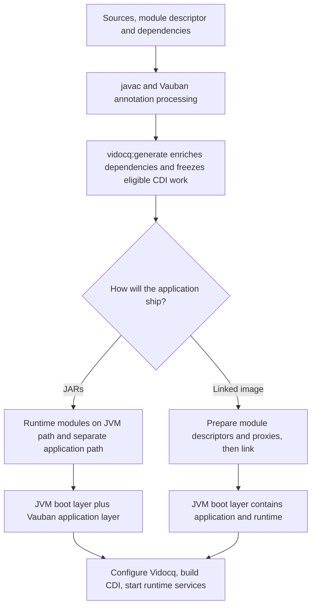
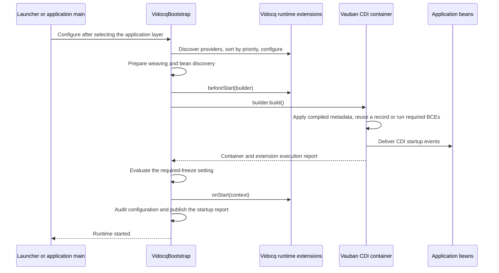

# How a Vidocq application starts

**Development line on 18 November 2026.** Follow one application from its Maven build to the first application callback. The worked example is the runtime's `acme.app` fixture. Its entry point calls `Vidocq.run(args)`. A CDI observer looks up a resource through a library, counts a service and calls another module that requires `java.sql`. That observer runs in development, in the JAR distribution and in the linked image. [Measurements and architecture review](2026-11-18-runtime-review.md) · [AppLayerImageIT](https://codefloe.com/Vidocq/vidocq/src/commit/818a4003fb514c5c67e3c73393feedc9e042b7a4/vidocq-runtime-integration-tests/vidocq-runtime-it-app-layer/src/test/java/io/vidocq/runtime/it/applayer/AppLayerImageIT.java)

## 1. What the build gives the launcher

1. **Compile the application module.** Javac reads the application sources and module descriptor. Vauban's annotation processor examines bean classes and the extensions on the processor path. It generates indexes and, where applicable, factories, component providers, proxies, intercepted subclasses and invokers. Extension code-generation bundles bring the processing needed for the selected bricks. Generated components can access members in their owning package without opening the entire application to reflection. [VaubanProcessor](https://codefloe.com/Vidocq/vauban/src/commit/bd38e9526b82d126a6b528b7cb179a100753210c/vauban-processor/src/main/java/io/vidocq/vauban/processor/VaubanProcessor.java) · [GeneratedInvokerCompileTimeTest](https://codefloe.com/Vidocq/vauban/src/commit/bd38e9526b82d126a6b528b7cb179a100753210c/vauban-processor/src/test/java/io/vidocq/vauban/processor/apt/GeneratedInvokerCompileTimeTest.java)
2. **Complete generation on the deployment.** At `process-classes`, `vidocq:generate` selects dependency archives needing processing, runs the relevant generators and builds enriched copies. Generated classes for a library belong with the library that owns their package. This avoids splitting that package between the application and a dependency. The build can therefore ship different bytes from the original Maven dependency. [VidocqGenerateMojo](https://codefloe.com/Vidocq/vidocq/src/commit/818a4003fb514c5c67e3c73393feedc9e042b7a4/vidocq-runtime-maven-plugin/src/main/java/io/vidocq/runtime/maven/VidocqGenerateMojo.java)
3. **Freeze deployment-wide CDI work.** On the assembled path the freezer captures eligible extension effects. The application output contains the deployment record, annotation additions and synthetic-component descriptions. Eligible invokers also get class files. Some applications already completed their extension work during compilation and need no deployment record. The goal writes `META-INF/vidocq/generate.stamp` after generation finishes. [ExtensionFreezer](https://codefloe.com/Vidocq/vauban/src/commit/bd38e9526b82d126a6b528b7cb179a100753210c/vauban-maven-plugin/src/main/java/io/vidocq/vauban/maven/generate/ExtensionFreezer.java) · [FrozenExtensions](https://codefloe.com/Vidocq/vauban/src/commit/bd38e9526b82d126a6b528b7cb179a100753210c/vauban-core/src/main/java/io/vidocq/vauban/core/extensions/FrozenExtensions.java) · [VidocqGenerateMojo](https://codefloe.com/Vidocq/vidocq/src/commit/818a4003fb514c5c67e3c73393feedc9e042b7a4/vidocq-runtime-maven-plugin/src/main/java/io/vidocq/runtime/maven/VidocqGenerateMojo.java)
4. **Choose the distribution.** A JAR distribution keeps framework and application archives available to separate loaders. For a linked image, the build prepares named modules, places eligible library proxies, promotes service declarations, chooses roots and invokes `jlink`. An encrypted application archive requires the JAR distribution and its loader. The image goal checks for these archives before linking. [VidocqJlinkMojo](https://codefloe.com/Vidocq/vidocq/src/commit/818a4003fb514c5c67e3c73393feedc9e042b7a4/vidocq-runtime-maven-plugin/src/main/java/io/vidocq/runtime/maven/VidocqJlinkMojo.java) · [StagedProvides](https://codefloe.com/Vidocq/vidocq/src/commit/818a4003fb514c5c67e3c73393feedc9e042b7a4/vidocq-runtime-maven-plugin/src/main/java/io/vidocq/runtime/maven/StagedProvides.java) · [StagedProxies](https://codefloe.com/Vidocq/vidocq/src/commit/818a4003fb514c5c67e3c73393feedc9e042b7a4/vidocq-runtime-maven-plugin/src/main/java/io/vidocq/runtime/maven/StagedProxies.java)

## 2. Which loader owns the application

A **module** defines names, dependencies and access. A **layer** contains a particular resolution of modules. A **class loader** defines Java classes. Several modules can share one loader, and the boot layer itself uses several JDK loaders. Defining the same binary class name through two loaders creates two types. This is how adding an apparently harmless second application layer can duplicate providers or break type-based CDI lookups. [JDK 25 ModuleLayer](https://docs.oracle.com/en/java/javase/25/docs/api/java.base/java/lang/ModuleLayer.html) · [VaubanLayerFactory](https://codefloe.com/Vidocq/vauban/src/commit/bd38e9526b82d126a6b528b7cb179a100753210c/vauban-classloader/src/main/java/io/vidocq/vauban/classloader/VaubanLayerFactory.java)

| Entry point | Default placement | What changes |
|---|---|---|
| `vidocq:run` | Runtime in the boot layer, selected application classes and libraries in a child layer | The launcher supplies the application path explicitly. |
| `vidocq:dev` | Same split in a child JVM controlled by Maven | Build output can change. The watcher, reload loop and optional redefinition agent coordinate changes. |
| Launcher from `vidocq:package`, Docker `kind=jdk` | Distribution with child application layer | Application archives remain available as files. The loader can transform classes and use secured-JAR plugins. |
| `vidocq:jlink`, `vidocq:jpackage`, Docker `kind=jlink` | Application and staged libraries in the boot layer | Launcher options root the modules and set `-Dvidocq.app.layer.off=true`. JDK loaders serve resources from the image. |
| Plain IDE launch of an application trampoline | The IDE may already have resolved the application on the module path | Re-layering the caller can leave two application copies. Vidocq diagnoses the overlap with `VIDOCQ-LAY-001`. The generated launch configuration and Maven launch are useful comparison points. |
| Explicit legacy flat launch | The configured launcher suppresses the child layer | Useful when interpreting a trace from `vidocq.package.layer=false` or `vidocq.dev.layer=false`. |

With `vidocq.app.layer=all`, the child normally holds project output and application dependencies, subject to the runtime's split and keep rules. A runtime extension that needs an application library can also be placed there. The `classes` setting narrows the split. Neither setting partitions a linked image. `@VidocqTest` uses the runtime's split for its test path, which also contains test classes. [Shipping formats](https://codefloe.com/Vidocq/vidocq/src/commit/818a4003fb514c5c67e3c73393feedc9e042b7a4/docs/en/modules/ROOT/pages/shipping.adoc) · [ImageLaunch](https://codefloe.com/Vidocq/vidocq/src/commit/818a4003fb514c5c67e3c73393feedc9e042b7a4/vidocq-runtime-maven-plugin/src/main/java/io/vidocq/runtime/maven/ImageLaunch.java) · [VidocqAppLayer](https://codefloe.com/Vidocq/vidocq/src/commit/818a4003fb514c5c67e3c73393feedc9e042b7a4/vidocq-runtime-core/src/main/java/io/vidocq/runtime/core/VidocqAppLayer.java)

**In a JAR launch**, `VidocqAppLayer.installIfConfigured()` reads `vidocq.app.path`. Vauban builds a finder, promotes service declarations as needed, chooses the found modules as roots and calls `resolveAndBind` against the parent configuration. It creates a `VaubanClassLoader` for the resolved archives and maps the child modules to it with `ModuleLayer.defineModules`. Vidocq sets the booting thread's context class loader to that loader before reading application configuration or discovering extensions. If the launcher names an application main, the runtime can hand control to it inside the installed layer. [VidocqAppLayer](https://codefloe.com/Vidocq/vidocq/src/commit/818a4003fb514c5c67e3c73393feedc9e042b7a4/vidocq-runtime-core/src/main/java/io/vidocq/runtime/core/VidocqAppLayer.java) · [VaubanLayerFactory](https://codefloe.com/Vidocq/vauban/src/commit/bd38e9526b82d126a6b528b7cb179a100753210c/vauban-classloader/src/main/java/io/vidocq/vauban/classloader/VaubanLayerFactory.java) · [Vidocq](https://codefloe.com/Vidocq/vidocq/src/commit/818a4003fb514c5c67e3c73393feedc9e042b7a4/vidocq-runtime-core/src/main/java/io/vidocq/runtime/core/Vidocq.java)

**In an image**, the JVM launches the application's main when configured, or the runtime main with the application module identified. The packaged JVM options resolve modules that supply resources or services even if no ordinary dependency roots them. With one copy of each application module, `ServiceLoader` can find its provider once. Libraries that enumerate resources can use `ApplicationLayer.home()` in both forms. In the image `current()` is empty, while `home()` can return the layer of the named application module. `ApplicationLayer.list` reads module entries because a class loader need not expose directory entries. [ImageLaunch](https://codefloe.com/Vidocq/vidocq/src/commit/818a4003fb514c5c67e3c73393feedc9e042b7a4/vidocq-runtime-maven-plugin/src/main/java/io/vidocq/runtime/maven/ImageLaunch.java) · [ApplicationLayer](https://codefloe.com/Vidocq/vidocq/src/commit/818a4003fb514c5c67e3c73393feedc9e042b7a4/vidocq-runtime-spi/src/main/java/io/vidocq/runtime/spi/ApplicationLayer.java)

## 3. What happens inside the JVM

**Configuration.** A server-style trampoline calls `Vidocq.run(args)`, which identifies the caller's module. The runtime's default main can start an application that has no main of its own. Both routes reach the bootstrap. Configuration sources can see application resources through the selected loader. The bootstrap resolves launch mode and report verbosity. It instantiates `VidocqExtension` providers with `ServiceLoader`, sorts them by increasing priority and calls `configure`. A brick that contributes only CDI extensions may appear as “CDI only” in the report. [Vidocq](https://codefloe.com/Vidocq/vidocq/src/commit/818a4003fb514c5c67e3c73393feedc9e042b7a4/vidocq-runtime-core/src/main/java/io/vidocq/runtime/core/Vidocq.java) · [ExtensionLoader](https://codefloe.com/Vidocq/vidocq/src/commit/818a4003fb514c5c67e3c73393feedc9e042b7a4/vidocq-runtime-core/src/main/java/io/vidocq/runtime/core/ExtensionLoader.java) · [VidocqBootstrap](https://codefloe.com/Vidocq/vidocq/src/commit/818a4003fb514c5c67e3c73393feedc9e042b7a4/vidocq-runtime-core/src/main/java/io/vidocq/runtime/core/VidocqBootstrap.java)

**Container creation.** The bootstrap prepares weaving, creates the Vauban builder, selects discovery inputs, and lets each runtime extension contribute in `beforeStart`. An IDE build missing generated metadata can trigger extra archive scanning. Vauban builds the deployment, installs contexts, validates it and delivers CDI startup events. A startup observer can refuse invalid live configuration here. In the fixture, this is when the application prints its loader and provider count, before Vidocq prints its final started line. [VidocqBootstrap](https://codefloe.com/Vidocq/vidocq/src/commit/818a4003fb514c5c67e3c73393feedc9e042b7a4/vidocq-runtime-core/src/main/java/io/vidocq/runtime/core/VidocqBootstrap.java) · [VaubanContainerBuilder](https://codefloe.com/Vidocq/vauban/src/commit/bd38e9526b82d126a6b528b7cb179a100753210c/vauban-core/src/main/java/io/vidocq/vauban/core/container/VaubanContainerBuilder.java) · [JwtConfigurationCheck](https://codefloe.com/Vidocq/cervantes/src/commit/204aa916a02b52e5b2a56f5b4f986a9aa42fc936/cervantes-cdi-vauban/src/main/java/io/vidocq/cervantes/cdi/internal/JwtConfigurationCheck.java)

**Services and application work.** After the builder returns, Vidocq inspects the BCE execution result and applies its freeze requirement. Runtime extensions receive `onStart` with the ready container. Depending on the installed extensions, they connect the HTTP listener, servlet or REST handlers and other services. For a waiting server, `Vidocq.run(args)` remains blocked until shutdown. For a command-style application, `Vidocq.run(AppClass.class, args)` resolves or constructs the application instance, invokes its callback, shuts down and returns its exit code. A CDI startup observer, an extension's `onStart` hook and a command's `run` method are distinct moments. [Vidocq](https://codefloe.com/Vidocq/vidocq/src/commit/818a4003fb514c5c67e3c73393feedc9e042b7a4/vidocq-runtime-core/src/main/java/io/vidocq/runtime/core/Vidocq.java) · [VidocqBootstrap](https://codefloe.com/Vidocq/vidocq/src/commit/818a4003fb514c5c67e3c73393feedc9e042b7a4/vidocq-runtime-core/src/main/java/io/vidocq/runtime/core/VidocqBootstrap.java)

**Stopping.** The runtime registers a JVM shutdown hook after successful boot. Teardown calls the extensions in reverse order and closes the container. If the start phase fails, the bootstrap records the failing step and attempts cleanup of extensions reached during `beforeStart` and of any container already built. This matters for a partially started application that has already opened a pool or listener. [VidocqBootstrap](https://codefloe.com/Vidocq/vidocq/src/commit/818a4003fb514c5c67e3c73393feedc9e042b7a4/vidocq-runtime-core/src/main/java/io/vidocq/runtime/core/VidocqBootstrap.java)

## 4. When a build compatible extension actually runs

A **Vidocq runtime extension** participates in the process lifecycle. A **CDI build compatible extension** (BCE) changes the CDI deployment model. A feature can supply both. Freezing a BCE leaves the runtime extension's lifecycle hooks and the application's CDI observers active. [Jakarta CDI 4.1 specification](https://jakarta.ee/specifications/cdi/4.1/jakarta-cdi-spec-4.1.html) · [ExtensionLoader](https://codefloe.com/Vidocq/vidocq/src/commit/818a4003fb514c5c67e3c73393feedc9e042b7a4/vidocq-runtime-core/src/main/java/io/vidocq/runtime/core/ExtensionLoader.java)

During the CDI extension cycle, discovery contributes types and metadata, enhancement changes the model, registration observes registered beans and observers, synthesis contributes synthetic components, and validation can reject the deployment. The processor can handle archive-local work while compiling. The later freezer sees the assembled deployment path. It captures registration effects in metadata, writes eligible invoker classes, and records which extensions need startup execution. Application-specific work can therefore be present as ordinary generated classes, as recorded metadata, or as remaining code that executes during startup. [VaubanProcessor](https://codefloe.com/Vidocq/vauban/src/commit/bd38e9526b82d126a6b528b7cb179a100753210c/vauban-processor/src/main/java/io/vidocq/vauban/processor/VaubanProcessor.java) · [VaubanContainerBuilder](https://codefloe.com/Vidocq/vauban/src/commit/bd38e9526b82d126a6b528b7cb179a100753210c/vauban-core/src/main/java/io/vidocq/vauban/core/container/VaubanContainerBuilder.java) · [InvokerClasses](https://codefloe.com/Vidocq/vauban/src/commit/bd38e9526b82d126a6b528b7cb179a100753210c/vauban-core/src/main/java/io/vidocq/vauban/core/extensions/InvokerClasses.java)

| What startup finds | What Vauban does | How to interpret it |
|---|---|---|
| Archives fully handled during compilation | Uses their generated components | No deployment freeze record is required when no BCE remains to run. |
| One matching deployment record | Loads its discovery results, enhancements and synthetic components | The report gives the count frozen at build. Startup observers still run. |
| Matching record with explicitly deferred extensions | Reuses the captured work and runs the listed extensions | Inspect both the frozen and the startup lists to establish which code ran. |
| Missing, ambiguous, unreadable or stale record with runtime BCE work remaining | Runs the applicable extension cycle at startup | Dev/test path additions can explain this. In production a refused record is a diagnostic signal. Strict mode can reject this boot. |

The main record lives at `META-INF/vauban-frozen-extensions.properties`. Its sibling files are `vauban-frozen-enhancements.properties` and `vauban-frozen-synthetic.properties`. A usable record belongs to one application deployment. The comparison covers discovery settings, relevant class models, extension code and, for newer records, additional model classes read by the BCE. Normal application method bodies and debug data are deliberately excluded from the bean model checksum. The freeze record is consequently suitable for deciding whether CDI metadata can be reused. Artifact authenticity requires release-level verification. [FrozenExtensions](https://codefloe.com/Vidocq/vauban/src/commit/bd38e9526b82d126a6b528b7cb179a100753210c/vauban-core/src/main/java/io/vidocq/vauban/core/extensions/FrozenExtensions.java) · [ClassChecksums](https://codefloe.com/Vidocq/vauban/src/commit/bd38e9526b82d126a6b528b7cb179a100753210c/vauban-core/src/main/java/io/vidocq/vauban/core/container/ClassChecksums.java) · [DeploymentFingerprint](https://codefloe.com/Vidocq/vauban/src/commit/bd38e9526b82d126a6b528b7cb179a100753210c/vauban-core/src/main/java/io/vidocq/vauban/core/container/DeploymentFingerprint.java)

For example, a security extension can register a bean and pass build-derived information to it. The bean reads the deployment's JWT configuration as a `Startup` observer. This allows the same packaged image to start with the production environment and to reject an invalid setting there. Reading that setting inside a BCE phase during the build would capture the builder's environment instead. [JwtConfigurationCheck](https://codefloe.com/Vidocq/cervantes/src/commit/204aa916a02b52e5b2a56f5b4f986a9aa42fc936/cervantes-cdi-vauban/src/main/java/io/vidocq/cervantes/cdi/internal/JwtConfigurationCheck.java) · [Writing a BCE](../writing-a-build-compatible-extension.md)

## 5. What a save does in development

The Maven process watches project inputs and recompiles them. Its child JVM owns the running application. The child preloads classes from application output directories without initializing them, reducing the chance that an existing request loses a class when the compiler replaces its output. A successful eligible method-body edit can be applied by the dev agent to the loaded class. Existing beans and the current layer survive. [ClassPreload](https://codefloe.com/Vidocq/vidocq/src/commit/818a4003fb514c5c67e3c73393feedc9e042b7a4/vidocq-runtime-core/src/main/java/io/vidocq/runtime/core/ClassPreload.java) · [VidocqDevReloadLoop](https://codefloe.com/Vidocq/vidocq/src/commit/818a4003fb514c5c67e3c73393feedc9e042b7a4/vidocq-runtime-core/src/main/java/io/vidocq/runtime/core/VidocqDevReloadLoop.java)

A structural change can require a swap. Vidocq stops the current deployment, handles eligible development-session state, restores the previous context loader, deregisters layer-owned JDBC drivers, reports threads retaining the loader, and closes the old archive readers. The loop then constructs a fresh layer and CDI deployment. Objects retained outside the old deployment can delay collection. A restart test can pass even while an old loader leaks, which is why the repository also checks the number of live loaders after repeated swaps. [VidocqAppLayer](https://codefloe.com/Vidocq/vidocq/src/commit/818a4003fb514c5c67e3c73393feedc9e042b7a4/vidocq-runtime-core/src/main/java/io/vidocq/runtime/core/VidocqAppLayer.java) · [AppLayerReloadLeakIT](https://codefloe.com/Vidocq/vidocq/src/commit/818a4003fb514c5c67e3c73393feedc9e042b7a4/vidocq-runtime-integration-tests/vidocq-runtime-it-app-layer/src/test/java/io/vidocq/runtime/it/applayer/AppLayerReloadLeakIT.java)

In this review, adding a method to the temporary fixture's `Probe` caused a layer swap. Its startup observer ran again and still found one service. Changing only the body of `AppTool.run` then redefined one class in place. This distinction explains why some edits preserve a bean instance and others run startup observers again. [AppLayerDevIT](https://codefloe.com/Vidocq/vidocq/src/commit/818a4003fb514c5c67e3c73393feedc9e042b7a4/vidocq-runtime-integration-tests/vidocq-runtime-it-app-layer/src/test/java/io/vidocq/runtime/it/applayer/AppLayerDevIT.java)

## 6. Reading a surprising startup report

| Observation | First check |
|---|---|
| `VIDOCQ-LAY-001` or two copies of an application provider | Compare the JVM module path with `vidocq.app.path`. A direct IDE launch can put the application in both layers. |
| A library sees a resource in dev but cannot enumerate its directory in an image | Inspect the resolved module and resource owner. Use the application layer SPI for enumeration. Check package openness when a different module must read a resource. |
| `VIDOCQ-GEN-001` | Check `META-INF/vidocq/generate.stamp` and `META-INF/vauban-beans.list`. The runtime reports the archives it had to index after a missing or stale generation step. |
| `VIDOCQ-GEN-002` | A module has bean classes and lacks its Vauban index. Check annotation processing for that module and the JDK used by the IDE compiler. |
| `VIDOCQ-GEN-003` | Read the refusal reason and compare the packaged path with the build path. Look for an extra record in a library, changed model classes or different discovery inputs. |
| The report says “frozen”, but a proxy or invoker uses reflection | Inspect generated components for the particular bean, return type and owner package. Freezing registration metadata and generating an executable implementation are separate build outputs. |
| A strict freeze check passes, but some BCEs ran | Check `ranAtStart()` and the named deferred extensions. `vidocq.startup.require-frozen-extensions=true` rejects remaining BCE work executed without an accepted record. It also permits deployments whose work was completed at compile time. |

The most informative first comparison is the same application, built once, observed from inside its startup callback. Record its module, defining loader, service count and one real operation through the injected component. The report shows how the container booted. The callback shows what the application received. [RefusedRecord](https://codefloe.com/Vidocq/vidocq/src/commit/818a4003fb514c5c67e3c73393feedc9e042b7a4/vidocq-runtime-core/src/main/java/io/vidocq/runtime/core/RefusedRecord.java) · [VidocqBootstrap](https://codefloe.com/Vidocq/vidocq/src/commit/818a4003fb514c5c67e3c73393feedc9e042b7a4/vidocq-runtime-core/src/main/java/io/vidocq/runtime/core/VidocqBootstrap.java) · [AppLayerImageIT](https://codefloe.com/Vidocq/vidocq/src/commit/818a4003fb514c5c67e3c73393feedc9e042b7a4/vidocq-runtime-integration-tests/vidocq-runtime-it-app-layer/src/test/java/io/vidocq/runtime/it/applayer/AppLayerImageIT.java)
